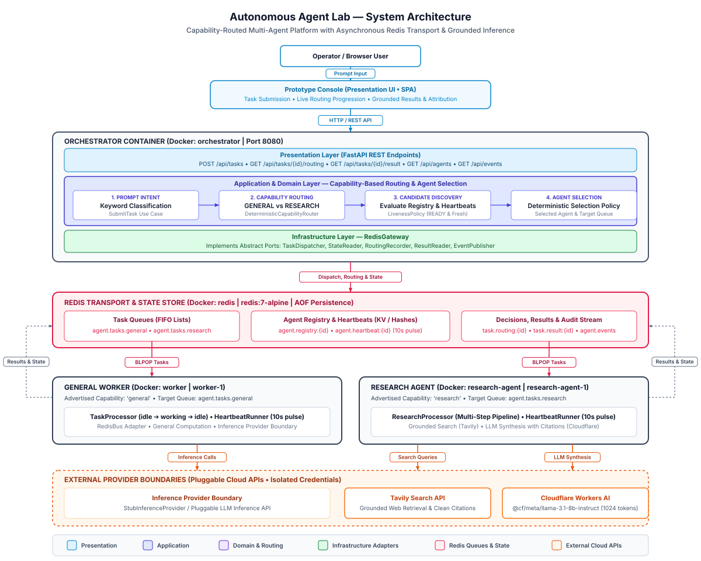

# Architecture Specification: Autonomous Agent Lab

## 1. Project Purpose & System Context

**Autonomous Agent Lab** is an independent, host-agnostic experimental testbed designed for research into:
* Autonomous agent state machines and lifecycles.
* Asynchronous message-driven agent-to-agent communication and task dispatching.
* Dynamic capability-based routing and candidate discovery with liveness evaluation.
* Specialized multi-agent execution (General Worker and Grounded Research Agent).
* Model Context Protocol (MCP) and tool integrations.
* Persistent state storage, decision recording, and real-time observability.
* Clean Architecture concentric boundaries and credential isolation.

### Authoritative Architecture Diagrams
* **Standalone Vector SVG**: [docs/architecture.svg](architecture.svg) — Slide-grade vector diagram rendered directly below; optimized for 30-second architectural comprehension on high-resolution displays and slides.
* **Editable Draw.io XML**: [docs/architecture.drawio](architecture.drawio) — Authoritative diagram model for iterative design, compatible with [draw.io](https://app.diagrams.net/) and the VS Code Draw.io extension (`hediet.vscode-drawio`).



### Explicit Independence
This repository is completely greenfield and independent. It maintains no coupling, shared code, or inherited assumptions from any external codebase or predecessor project.

---

## 2. Hosting & Deployment Models

### Current Hosting Model
* **Runtime Containerization**: Docker Compose (`compose.yaml`).
* **Network Topology**: Single bridge network (`agent_net`) with port mapping for the presentation dashboard (`8080:8080`) and internal DNS routing (`orchestrator`, `worker`, `research-agent`, `redis`).
* **Container Inventory**:
  1. `orchestrator`: Presentation API and dynamic capability orchestration engine.
  2. `worker`: General computation agent (`worker-1`) consuming `agent.tasks.general`.
  3. `research-agent`: Specialized autonomous research agent (`research-agent-1`) consuming `agent.tasks.research`.
  4. `redis`: Append-Only File (AOF) state, message queue, and stream hub (`redis:7-alpine`).
  5. `cloudflared`: Optional secure tunnel container for zero-port-forward remote ingress.

### External System Boundaries
* **Tavily Search API**: Grounded web search retrieval (`https://api.tavily.com/search`).
* **Cloudflare Workers AI**: Serverless LLM synthesis (`@cf/meta/llama-3.1-8b-instruct`) with strict output token budget.

---

## 3. Clean Architecture & Layer Boundaries

The codebase strictly enforces Clean Architecture concentric layering with inward-pointing dependencies. The application core remains 100% decoupled from web frameworks, storage engines, and external AI providers. The authoritative system architecture diagram above illustrates how these concentric rings map onto runtime services, messaging paths, and external providers.

### Architectural Layering & Dependency Inversion

1. **Domain Layer (Center Ring)**: Pure business logic and domain invariants. Encapsulates intent routing rules (`DeterministicCapabilityRouter`), capability classifications (`AgentCapability`), and candidate selection policies (`DeterministicSelectionPolicy`). Contains zero dependencies on infrastructure, databases, or frameworks.
2. **Application Layer (Use Cases & Ports)**: Orchestrates business flows (`SubmitTask`, `GetRoutingDecision`, `FindCandidatesByCapability`). Declares abstract Ports (Protocols) such as `TaskDispatcher`, `TaskQueue`, `StateReader`, `RoutingRecorder`, `ResultReader`, and `EventPublisher`. Does not know about Redis, HTTP, or external cloud providers.
3. **Infrastructure Layer (Adapters)**: Implements application ports with concrete technologies. `RedisGateway` connects the orchestrator to Redis data structures; `RedisBus` connects workers to dispatch queues; `TavilySearchExecutor` and `CloudflareInferenceProvider` adapt external APIs.
4. **Presentation Layer (Outer Ring)**: Exposes FastAPI REST endpoints (`/api/tasks`, `/api/tasks/{id}/routing`, `/api/tasks/{id}/result`, `/api/agents`, `/api/events`) and serves the Prototype Console single-page web application. Interacts exclusively with Application use cases and queries.
5. **Shared Contracts (`agent_contracts`)**: Cross-boundary data primitives (`TaskRequested`, `TaskResult`, `RoutingDecision`, `CandidateEvaluation`, `AgentHeartbeat`, `AgentEvent`, `AgentCandidate`, `AgentAvailability`, `LivenessPolicy`). Technology-neutral dataclasses with strict versioning and automated credential sanitization.

### Layer Definitions & Invariants

| Layer | Components | Inward Dependencies | Disallowed Dependencies |
| :--- | :--- | :--- | :--- |
| **Domain** | Entities (`Task`), Capability enums (`AgentCapability`), Intent routers (`DeterministicCapabilityRouter`), Selection policies (`DeterministicSelectionPolicy`), Domain errors (`CapabilityUnavailableError`). | Standard library only. | **Zero** external libraries. No FastAPI, Redis, Docker, Tavily, or Cloudflare. |
| **Application** | Use cases (`SubmitTask`), queries (`GetRoutingDecision`, `FindCandidatesByCapability`, `GetAgentStates`, `GetRecentEvents`, `GetTaskResult`), abstract ports/protocols (`TaskDispatcher`, `TaskQueue`, `StateReader`, `ResultReader`, `RoutingRecorder`, `EventPublisher`). | Domain models, standard library, shared contracts. | Concrete infrastructure adapters, database drivers, web frameworks (`redis`, `fastapi`, `httpx`). |
| **Infrastructure** | Concrete adapters implementing ports (`RedisGateway`, `RedisBus`), external client executors (`TavilySearchExecutor`, `CloudflareInferenceProvider`), factory helpers (`create_research_executor`, `create_inference_provider`). | Application ports, shared contracts, third-party drivers (`redis.asyncio`, `httpx`). | Presentation layer, domain bypass. |
| **Presentation** | HTTP REST endpoints (`api.py`), static Prototype Console dashboard (`index.html`), request schemas (`TaskInput`), response serialization. | Application use cases and queries, standard library, FastAPI/Pydantic. | Direct access to concrete infrastructure adapters; presentation must never query `RedisGateway` directly. |
| **Shared Contracts** | Cross-boundary primitives (`TaskRequested`, `RoutingDecision`, `CandidateEvaluation`, `TaskResult`, `AgentEvent`, `AgentHeartbeat`, `AgentCandidate`, `AgentAvailability`, `LivenessPolicy`). | Standard library (`dataclasses`, `json`, `uuid`, `datetime`). | Infrastructure details, service-internal logic, database formatting rules. |

---

## 4. Composition Root & Dependency Injection

The application adheres to the **Composition Root pattern** rather than scattering dependency decorators across routes:

* **Factory Function**: The orchestrator presentation layer exposes `create_app(settings, gateway, task_queue, state_reader) -> FastAPI`.
* **Central Wiring**: The composition root constructs concrete infrastructure adapters (`RedisGateway`), wires them into application commands (`SubmitTask`) and queries (`GetAgentStates`, `GetRecentEvents`, `GetRoutingDecision`, `GetTaskResult`), and attaches them to `app.state`.
* **Resource Lifecycle**: FastAPI's `lifespan` context manager governs connection pools, guaranteeing that `gateway.aclose()` executes gracefully during SIGTERM/shutdown.
* **Test Isolation**: Tests instantiate `create_app()` passing lightweight in-memory fake adapters, running full endpoint validation without connecting to Redis or binding ports.

---

## 5. End-to-End Orchestration & Execution Flows

### Flow 1: Task Submission & Capability Routing
1. **Submission**: The operator submits a task prompt via the Prototype Console or `POST /api/tasks`.
2. **Intent Classification**: `SubmitTask` use case invokes `DeterministicCapabilityRouter` to determine the required capability:
   - Keywords matching research/investigation (e.g. *research, investigate, compare, analyze*) resolve to `AgentCapability.RESEARCH`.
   - General computation tasks resolve to `AgentCapability.GENERAL`.
3. **Candidate Discovery & Liveness Check**: `SubmitTask` invokes `CandidateFinder` (`FindCandidatesByCapability`), which queries registered agents from `agent.registry:*` and evaluates their latest pulse in `agent.heartbeat:*` using `LivenessPolicy` (must be `READY` and heartbeat fresher than stale threshold).
4. **Agent Selection**:
   - If eligible candidates exist, `DeterministicSelectionPolicy` deterministically selects the optimal candidate based on heartbeat freshness and agent ID.
   - If zero eligible candidates exist, `RoutingDecision` is recorded as rejected, an error event is emitted, and `CapabilityUnavailableError` is raised (HTTP 503).
5. **Decision Recording**: `SubmitTask` constructs a structured, immutable `RoutingDecision` capturing the task ID, prompt classification, required capabilities, candidate evaluations, selected agent ID, dispatch target queue, and selection rationale. It persists this record via `RoutingRecorder.record_routing_decision()` to `task.routing:{task_id}`.
6. **Task Dispatch**: `SubmitTask` dispatches `TaskRequested` to the selected candidate's advertised target queue (e.g. `agent.tasks.research` or `agent.tasks.general`) via `TaskDispatcher`.

### Flow 2: Worker Execution & Grounded Research Synthesis
1. **Task Dequeue**: The target agent's `RedisBus` performs an atomic `BLPOP` on its queue.
2. **State Transition**: The agent transitions its state hash from `idle` to `working` and publishes an operational `working` event to `agent.events`.
3. **Execution**:
   - **General Worker (`worker-1`)**: Processes the prompt using its configured `InferenceProvider`.
   - **Research Agent (`research-agent-1`)**:
     a. **Retrieval**: Queries `TavilySearchExecutor` (`https://api.tavily.com/search`) for grounded web content and source URLs.
     b. **Context Formatting**: Assembles grounded search evidence into an explicit token-budgeted prompt.
     c. **LLM Synthesis**: Calls `CloudflareInferenceProvider` (`@cf/meta/llama-3.1-8b-instruct`) with strict instructions to generate structured findings and concise source citations.
     d. **Truncation Detection**: Checks completion metadata and response boundaries to prevent silent mid-sentence truncation.
4. **Result Storage**: The agent constructs a `TaskResult` (`status="completed"`, `output=...`) and persists it to `task.result:{task_id}`.
5. **State Reset**: The agent transitions its state back to `idle` (`Waiting for work`) and publishes an `idle` event to `agent.events`.

### Flow 3: Observability & Console Presentation
1. **Routing Progression**: The Prototype Console immediately queries `GET /api/tasks/{task_id}/routing` upon submission and renders a 5-step visual pipeline:
   $$\text{Submitted} \longrightarrow \text{Capability: RESEARCH} \longrightarrow \text{Candidates Evaluated} \longrightarrow \text{Selected Agent} \longrightarrow \text{Execution}$$
2. **Rationale & Diagnostics**: The console displays the decision rationale and an expandable disclosure with candidate evaluation telemetry (Agent ID, Type, Capabilities, Status, Eligibility).
3. **Result Polling**: The console polls `GET /api/tasks/{task_id}/result` until completed, then formats the output with clickable, secure source links.
4. **Unavailable Capabilities**: If rejected with HTTP 503, the console displays the progression failure, missing capability, and troubleshooting guidance.

---

## 6. Service Communication & Contract Purity

### Network Boundaries
1. Deployable services (`services/orchestrator`, `services/worker`, `services/research_agent`) are isolated containers on Docker network `agent_net`.
2. Direct Python imports across service boundaries are strictly forbidden. One service must never import from another service's internal code tree.
3. Inter-service communication occurs exclusively through explicit asynchronous message passing and key-value state over Redis.

### Shared Contract Purity
* Shared contracts reside in `packages/contracts/src/agent_contracts`.
* Contracts are strictly versioned (`version: int = 1`).
* Contracts expose technology-neutral representations (`to_dict()`, `to_json()`, `from_dict()`, `from_json()`).
* **Security & Credential Isolation**:
  - Contracts enforce recursive sanitization against disallowed metadata keys (`api_key`, `secret`, `token`, `password`, `auth`).
  - Provider tokens (`TAVILY_API_KEY`, `CLOUDFLARE_AI_API_TOKEN`) are strictly confined to worker container environments; they are never passed through contracts, stored in Redis, or returned to the browser.

---

## 7. Container Design & Persistence Principles

### Container Disposability
* Application containers do not own authoritative durable state and are designed to be disposable.
* Durable state is externalized to the Redis persistence volume (`redis_data`).
* Redis is configured with Append-Only File persistence (`--appendonly yes`) to provide persistence across container replacement and restart.

### Redis Key Namespace Structure

| Key Pattern | Data Structure | Purpose |
| :--- | :--- | :--- |
| `agent.tasks.general` | Redis List (FIFO) | Dispatch queue for General Worker (`RPUSH` / `BLPOP`). |
| `agent.tasks.research` | Redis List (FIFO) | Dispatch queue for Research Agent (`RPUSH` / `BLPOP`). |
| `agent.registry:{agent_id}` | Redis String / Hash | Static agent registration, capabilities, and target queue. |
| `agent.heartbeat:{agent_id}` | Redis String / JSON | Periodic liveness pulse, execution state, and ISO timestamp. |
| `task.routing:{task_id}` | Redis String / JSON | Structured `RoutingDecision` record (candidates, target, rationale). |
| `task.result:{task_id}` | Redis String / JSON | Durable `TaskResult` record (status, synthesized output, completion time). |
| `agent.events` | Redis Stream (`XADD`) | Chronological operational audit log (maxlen=500). |

---

## 8. Agent State Machine & Error Recovery

The agents enforce an explicit state machine for task execution:

```text
       ┌──────────┐
       │   idle   │◄─────────────────────────────┐
       └────┬─────┘                              │
            │ (Picks up task via BLPOP)          │
            ▼                                    │
       ┌──────────┐                              │
       │ working  │                              │
       └────┬─────┘                              │
            │                                    │
     ┌──────┴────────────────┐                   │
     │ (Success)             │ (Execution Error) │
     ▼                       ▼                   │
┌──────────┐           ┌──────────┐              │
│   idle   │           │  error   │──────────────┘
└──────────┘           └──────────┘
```

1. **State vs. Event History**:
   * Current agent state is maintained in a Redis Hash / Heartbeat (`agent.heartbeat:{agent_id}`).
   * The complete chronological audit log is appended to a Redis Stream (`agent.events`).
2. **Failure Recovery**:
   * When task processing raises an exception, the agent appends an `error` event to `agent.events` retaining the failed `task_id` and error description.
   * Crucially, the agent transitions its status back to `idle` (`Waiting for work`), ensuring the worker does not remain permanently trapped in an error status and can process subsequent tasks.
3. **Transport Resilience**:
   * Redis operations are wrapped in exponential backoff policies (`retry_with_backoff[T]`).
   * Only transport errors (`ConnectionError`, `TimeoutError`, `OSError`) are retried. Non-transport defects fail immediately.

---

## 9. Observability & Logging Standards

* **Standard Output**: All logs are emitted to `sys.stdout` via standard Python `logging`.
* **Format**: Standard text logging using `%(asctime)s [%(levelname)s] %(name)s: %(message)s`.
* **Log Levels**:
  * `INFO`: Process startup, registration, task dispatch, task completion.
  * `WARNING`: Handled task execution failures, recoverable transport retries.
  * `ERROR` / `CRITICAL`: Unrecoverable transport exhaustion, application exit.
* **Correlated Telemetry**: Task IDs and Agent IDs are explicitly logged at dispatch, routing, and completion boundaries.

---

## 10. Testing Strategy by Layer

Testing follows the pyramid structure and relies on zero live infrastructure or cloud accounts:

* **Domain Unit Tests** (`tests/test_domain.py`, `tests/test_routing_decision.py`): Invariant tests verifying prompt boundaries, intent routing, selection policies, and sensitive key scrubbing.
* **Application Unit Tests** (`tests/test_application.py`, `tests/test_runtime_dispatch.py`, `tests/test_unavailable_capability.py`): Command and query validation using lightweight in-memory test doubles (`FakeTaskQueue`, `FakeStateReader`, `FakeCandidateFinder`).
* **Contract Tests** (`tests/test_contracts.py`): Round-trip JSON and dictionary serialization/deserialization verification across all shared contracts.
* **Worker & Research Agent Tests** (`tests/test_worker.py`, `tests/test_research_agent.py`): Verification of worker state progression (`working` → `idle`), research retrieval, Cloudflare synthesis, and truncation guard handling using mocked executors.
* **Presentation Tests** (`tests/test_presentation.py`): Endpoint testing using `create_app()` configured with in-memory test doubles—validating HTML structure, progression elements, HTTP 503 error schemas, and routing endpoint responses without live Redis connections.

---

## 11. Environment & Dependency Governance

### Python Runtime Alignment
* **Standard Rule**: **Use one explicitly supported Python minor version across local development, tests, and service containers.**
* **Authoritative Runtime**: **Python 3.12** (`>=3.12,<3.13`).
* **Parity**: Local virtual environment, Orchestrator container, Worker container, and Research Agent container all execute on CPython 3.12.x to prevent standard library drift.

### Dependency Management
* **Service Runtime Isolation**: Each service strictly maintains its own runtime dependencies in `services/<service>/requirements.txt`. Orchestrator web dependencies must never leak into worker containers.
* **Development Manifest**: The root `requirements-dev.txt` references all service manifests via `-r` and layers development/test tools (`pytest`, `anyio`, `ruff`).
* **Single Command Setup**: A clean checkout is provisioned locally via `python -m pip install -r requirements-dev.txt` or `make dev-install`.
* **Root `pyproject.toml` Role**: Acts strictly as workspace and tool configuration (`[tool.pytest.ini_options]`, `[tool.ruff]`, `requires-python`).

---

## 12. Technology Boundary & Deferred Capabilities

To preserve architectural simplicity and prevent speculative complexity, the following technologies are explicitly deferred:

| Deferred Technology | Reason for Deferral |
| :--- | :--- |
| **Relational Database (PostgreSQL)** | Redis AOF persistence completely satisfies current task queue, agent state, decision logging, and event stream needs. Relational storage will only be considered when complex multi-table analytical querying or relational durability requires it. |
| **Heavy Message Brokers (Kafka, RabbitMQ)** | Redis Lists and Streams are more than sufficient for current laboratory workloads without introducing JVM or Erlang cluster management. |
| **Kubernetes / Nomad** | Docker Compose bridge networking (`agent_net`) provides sufficient service discovery and container lifecycle management. |
| **Distributed APM (Jaeger, Prometheus, OTel)** | Stdout logging, routing diagnostic models, and Redis stream inspection satisfy current observability requirements without external telemetry collectors. |
| **Third-Party Agent Frameworks (LangChain, AutoGen, CrewAI)** | Agent prompt loops, state machines, and tool invocations must remain explicit Python domain code. External frameworks introduce heavy dependency churn and obfuscate boundary contracts. |

---

## 13. Governance: Modifying Architectural Boundaries

Significant architectural decisions require an Architecture Decision Record (ADR)
before implementation. Use the practical threshold and lightweight process in
[docs/adr/README.md](adr/README.md); routine implementation within accepted
boundaries does not require an ADR.

## 14. Runtime Tool Discovery Boundary

`agent_policy.ToolDiscoveryService` queries the shared `ToolRegistryReader` on
every discovery request and returns `ToolRegistration` values in registry order.
`ToolDiscoveryScope.categories` describes which catalog categories the caller
wants to inspect; an empty category set returns all currently registered tools.
The scope is immutable and category matching is case-insensitive.

Discovery eligibility is not execution authorization. It does not interpret
`AgentCapabilityMetadata.agent_type` or advertised `capabilities` as permission
grants, rank or select tools, or invoke them. Agent-type applicability and actual
permission grants remain undefined by the current contracts and are deferred to
the tool-selection and authorization increments.

`ToolRegistration.category` is the category source. A tool with
`ToolDefinition.metadata is None` can be discovered only after registration with
an explicit category; discovery does not synthesize metadata. The current
`InMemoryToolRegistry` is process-local: a discovery service sharing that live
instance sees later registrations, but this does not provide cross-process
discovery.

## 15. Bounded Provider-Neutral Tool Use

The tool-use policy consumes the current catalog through the existing
`ToolDiscoveryService`, then follows the stable boundaries of selection,
argument validation, an explicit authorization seam, execution, and a
continuation result. Selection contracts are provider-neutral and agent-neutral.
The deterministic selector is a replaceable reference implementation; its
matching behavior is not part of the selection contract.

The initial coordination policy permits at most one correction attempt, at most
one tool invocation, and one continuation path. The coordinator returns the
successful `ToolInvocationResult` for a concrete consumer to continue with; it
does not fabricate a natural-language synthesis or create an autonomous loop.
The current Research Agent and Worker flows are not wired to this generic
coordinator.

Execution crosses `TrustedCompositionToolInvoker` only under an explicitly
documented temporary trusted-composition assumption for deliberately supplied
prototype or test tools. Discovery eligibility is not execution authorization;
selection and registration are not authorization. Issue #27 remains responsible
for replacing this assumption with real permission and authorization
enforcement. Discovery remains process-local as described above.
