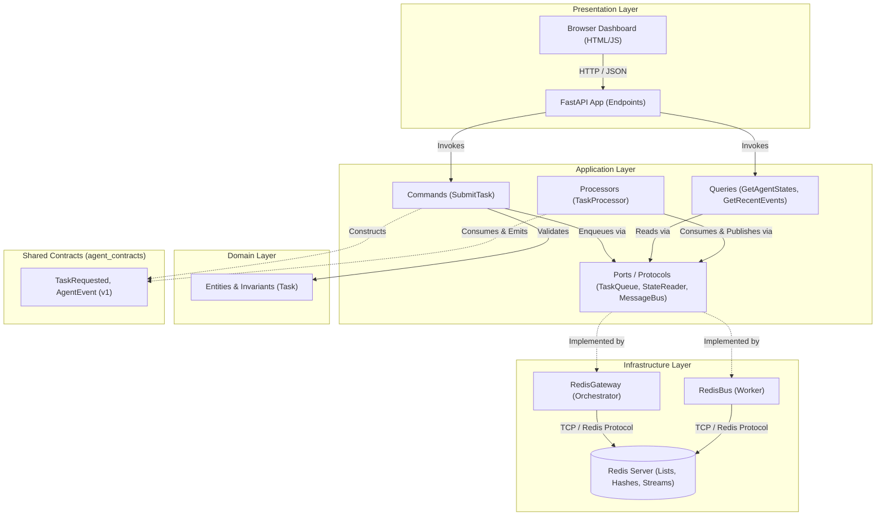

# Architecture Specification: Autonomous Agent Lab

## 1. Project Purpose & System Context

**Autonomous Agent Lab** is an independent, host-agnostic experimental testbed designed for research into:
* Autonomous agent state machines and lifecycles.
* Asynchronous message-driven agent-to-agent communication.
* Orchestration and task dispatching.
* Containerized execution isolation.
* Model Context Protocol (MCP) and tool integrations.
* Persistent state storage and observability.
* Eventual multi-agent collaboration across independent services.

### Explicit Independence
This repository is completely greenfield and independent. It maintains no coupling, shared code, or inherited assumptions from any external codebase or predecessor project.

---

## 2. Hosting & Deployment Models

### Current Hosting Model
* **Host OS**: Windows 11
* **Execution Environment**: WSL2 (Ubuntu 26.04)
* **Runtime Containerization**: Docker Compose
* **Network Topology**: Single bridge network (`agent_net`) with port mapping for the presentation dashboard (`8080:8080`) and internal DNS routing (`orchestrator`, `worker`, `redis`).

### Future Hosting Model (Architectural Goal)
* **Target Environment**: Standalone Linux mini PC running Docker Compose.
* **Portability Strategy**: Container images and configuration are fully host-agnostic, using POSIX path conventions, standard environment variable overrides, and internal container networking.
* **Portability Caveats**: Portability to a physical Linux mini PC is an architectural design goal, not a zero-effort automatic deployment. Deploying to physical hardware will require provisioning host directories, firewall permissions, physical networking, and environment variable configuration.

---

## 3. Clean Architecture & Layer Boundaries

The codebase enforces strict concentric layering with inward-pointing dependencies.



### Layer Definitions & Invariants

| Layer | Components | Inward Dependencies | Disallowed Dependencies |
| :--- | :--- | :--- | :--- |
| **Domain** | Entities, value objects, business validation invariants (`orchestrator.domain.task.Task`). | Standard library only. | **Zero** external libraries. No FastAPI, Redis, Docker, or databases. |
| **Application** | Use case commands (`SubmitTask`), queries (`GetAgentStates`, `GetRecentEvents`), abstract ports/protocols (`TaskQueue`, `StateReader`, `MessageBus`), processors (`TaskProcessor`), typed exceptions (`TaskExecutionError`). | Domain models, standard library, shared contracts. | Concrete infrastructure adapters, database drivers, web frameworks (`redis`, `fastapi`). |
| **Infrastructure** | Concrete adapters implementing ports (`RedisGateway`, `RedisBus`), transport backoff policies (`retry_with_backoff`), external clients. | Application ports, shared contracts, third-party drivers (`redis.asyncio`). | Presentation layer, domain bypass. |
| **Presentation** | HTTP endpoints, static dashboard serving, request parsing (`TaskInput`), response formatting. | Application use cases and queries, standard library, FastAPI/Pydantic. | Direct access to concrete infrastructure adapters; presentation must never query `RedisGateway` directly. |
| **Shared Contracts** | Cross-boundary message definitions (`TaskRequested`, `AgentEvent`). | Standard library (`dataclasses`, `json`, `uuid`, `datetime`). | Infrastructure details, service-internal logic, database formatting rules. |

---

## 4. Composition Root & Dependency Injection

The application adheres to the **Composition Root pattern** rather than scattering dependency decorators across routes:

* **Factory Function**: The orchestrator presentation layer exposes `create_app(settings, gateway, task_queue, state_reader) -> FastAPI`.
* **Central Wiring**: The composition root constructs concrete infrastructure adapters (`RedisGateway`), wires them into application commands (`SubmitTask`) and queries (`GetAgentStates`, `GetRecentEvents`), and attaches them to `app.state`.
* **Resource Lifecycle**: FastAPI's `lifespan` context manager governs connection pools, guaranteeing that `gateway.aclose()` executes gracefully during SIGTERM/shutdown.
* **Test Isolation**: Tests instantiate `create_app()` passing lightweight in-memory fake adapters, running full endpoint validation without connecting to Redis or binding ports.

---

## 5. Service Communication & Contract Purity

### Network Boundaries
1. Deployable services (`services/orchestrator`, `services/worker`) are isolated containers.
2. Direct Python imports across service boundaries are strictly forbidden. One service must never import from another service's internal tree.
3. Inter-service communication occurs exclusively through explicit asynchronous message passing over Redis.

### Shared Contract Purity
* Shared contracts live in `packages/contracts/src/agent_contracts`.
* Contracts are strictly versioned (`version: int = 1`).
* Contracts expose technology-neutral representations (`to_dict()`, `to_json()`, `from_dict()`, `from_json()`).
* **Storage Independence**: Serialization idiosyncrasies (e.g. converting `None` to empty strings for Redis hashes) are forbidden in contracts and are encapsulated within the corresponding infrastructure adapter (`RedisBus`).

---

## 6. Container Design & Persistence Principles

### Container Disposability
* Application containers do not own authoritative durable state and are designed to be disposable. However, under the current `BLPOP` delivery model, in-flight tasks can currently be lost if a worker container crashes or is terminated during processing.
* Durable state is strictly externalized to the Redis persistence volume (`redis_data`).
* Redis is configured with Append-Only File persistence (`--appendonly yes`) to provide persistence across container replacement and restart, without claiming guaranteed durability or backup.

### Security Boundary Note
* **Current Implementation**: Service containers currently execute under the default container user (`root`).
* **Future Hardening**: Adding a dedicated unprivileged user (`USER appuser`) and dropping Linux capabilities is planned for subsequent security hardening cycles.

---

## 7. Agent State Machine & Error Recovery

The worker enforces an explicit state machine for task execution:

```text
       ┌──────────┐
       │   idle   │◄─────────────────────────────┐
       └────┬─────┘                              │
            │ (Picks up task)                    │
            ▼                                    │
       ┌──────────┐                              │
       │ working  │                              │
       └────┬─────┘                              │
            │                                    │
     ┌──────┴────────────────┐                   │
     │ (Success)             │ (Execution Error) │
     ▼                       ▼                   │
┌──────────┐           ┌──────────┐              │
│   idle   │           │  error   │──────────────┘
└──────────┘           └──────────┘
```

1. **State vs. Event History**:
   * Current agent state is maintained in a Redis Hash (`agent.state:{agent_id}`).
   * The complete chronological audit log is appended to a Redis Stream (`agent.events`).
2. **Failure Recovery**:
   * When task processing raises an exception, the worker appends an `error` event to `agent.events` retaining the failed `task_id` and error description.
   * Crucially, the worker's current state hash is immediately transitioned back to `idle` (`Waiting for work`), ensuring the worker does not remain permanently trapped in an error status and can process subsequent tasks.
3. **Distinguishing Defects from Task Failures**:
   * Expected task processing failures raise `TaskExecutionError` which is caught, logged as a warning, and reported as an agent event.
   * Truly unexpected programming defects (e.g. `TypeError`, syntax errors) or system interrupts (`CancelledError`) are not masked and bubble up to prevent zombie execution.
4. **Transport Resilience**:
   * Redis operations are wrapped in `retry_with_backoff[T]` with capped exponential backoff (max 5 retries, 5.0s maximum delay).
   * Only transport errors (`ConnectionError`, `TimeoutError`, `OSError`) are retried. Non-transport bugs fail immediately.

---

## 8. Evolution Towards Multi-Agent Routing (Agent #2)

### Current Implementation
* **Single FIFO Queue**: Tasks are dispatched to a single Redis list (`agent.tasks`) using `RPUSH` and consumed via `BLPOP`.
* **Competing Consumers**: Multiple worker replicas currently act as competing consumers on the same queue (homogeneous horizontal scaling only).
* **Delivery Semantics**: Tasks are removed atomically upon dequeue (`BLPOP`); there is currently no acknowledgment or dead-letter queue.

### Future Architecture (Planned for Agent #2)
To support heterogeneous agents (e.g., specialized Agent #2) and agent-to-agent delegation:
1. **Message Routing Metadata**: Contracts must be extended with routing headers:
   * `target_agent_id: str | None` (directed addressing vs. broadcast).
   * `sender_id: str | None` (originating agent/service).
   * `correlation_id: str | None` (tracing conversational turns or parent task workflows).
   * `task_type: str` (specialized capability dispatching).
2. **At-Least-Once Delivery**: Transition from raw lists to Redis Consumer Groups (`XREADGROUP` / `XACK`) or explicit visibility timeouts to prevent task loss on container crash.

---

## 9. Observability & Logging Standards

* **Standard Output**: All logs are emitted to `sys.stdout` via standard Python `logging`.
* **Current Log Format**: Standard text logging using `%(asctime)s [%(levelname)s] %(name)s: %(message)s`. Structured JSON or machine-readable correlated logging is identified as a possible planned evolution rather than a current capability.
* **Log Levels**:
  * `INFO`: Process startup, registration, task dispatch, task completion.
  * `WARNING`: Handled task execution failures, recoverable transport retries.
  * `ERROR` / `CRITICAL`: Unrecoverable transport exhaustion, application exit.
* **Correlated Telemetry**: Task IDs and Agent IDs are explicitly logged at dispatch and completion boundaries.

---

## 10. Testing Strategy by Layer

Testing follows the pyramid structure and relies on zero live infrastructure for automated execution:

* **Domain Unit Tests** (`tests/test_domain.py`): Pure invariant tests verifying constraints (e.g. empty prompt rejection, length boundaries).
* **Application Unit Tests** (`tests/test_application.py`): Use case and query validation using lightweight in-memory test doubles (`FakeTaskQueue`, `FakeStateReader`).
* **Contract Tests** (`tests/test_contracts.py`): Round-trip JSON and dictionary serialization/deserialization verification.
* **Worker Unit Tests** (`tests/test_worker.py`): Verification of worker state progression (`working` → `idle` and `working` → `error` → `idle`), retry backoff policies, and non-retry of programming defects using `FakeMessageBus`.
* **Presentation Tests** (`tests/test_presentation.py`): Endpoint testing using `create_app()` configured with in-memory test doubles—validating HTTP inputs, status codes, and query limit bounds without live Redis connections.

---

## 11. Environment & Dependency Governance

### Python Runtime Alignment
* **Standard Rule**: **Use one explicitly supported Python minor version across local development, tests, and service containers.**
* **Authoritative Runtime**: **Python 3.12** (`>=3.12,<3.13`).
* **Parity**: Local WSL virtual environment, Orchestrator Docker container, and Worker Docker container all execute on CPython 3.12.x to prevent standard library and coroutine deprecation drift.

### Dependency Management
* **Service Runtime Isolation**: Each service strictly maintains its own runtime dependencies in `services/<service>/requirements.txt`. Orchestrator web dependencies must never leak into worker containers.
* **Development Manifest**: The root `requirements-dev.txt` references all service manifests via `-r` and layers development/test tools (`pytest`, `anyio`, `ruff`).
* **Single Command Setup**: A clean checkout is provisioned locally via `python -m pip install -r requirements-dev.txt` or `make dev-install`.
* **Root `pyproject.toml` Role**: Acts strictly as workspace and tool configuration (`[tool.pytest.ini_options]`, `[tool.ruff]`, `requires-python`). It is intentionally not an installable package distribution.

---

## 12. Technology Boundary & Deferred Capabilities

To preserve architectural simplicity and prevent speculative complexity, the following technologies are explicitly deferred:

| Deferred Technology | Reason for Deferral |
| :--- | :--- |
| **Relational Database (PostgreSQL)** | Redis AOF persistence completely satisfies current task queue, agent state, and event log needs. Relational storage will only be considered when complex multi-table querying or durability constraints require it. |
| **Heavy Message Brokers (Kafka, RabbitMQ)** | Redis Lists and Streams are more than sufficient for single-host laboratory workloads without introducing JVM or Erlang cluster management. |
| **Kubernetes / Nomad** | Docker Compose bridge networking (`agent_net`) provides sufficient service discovery and container lifecycle management. |
| **Distributed APM (Jaeger, Prometheus, OTel)** | Stdout logging and Redis stream inspection satisfy current observability requirements without external telemetry collectors. |
| **Third-Party Agent Frameworks (LangChain, AutoGen, CrewAI)** | Agent prompt loops, state machines, and tool invocations must remain explicit Python domain code. External frameworks introduce heavy dependency churn and obfuscate boundary contracts. |

---

## 13. Governance: Modifying Architectural Boundaries

> **Mandatory Rule**: Significant architectural decisions (such as altering layer boundaries, introducing shared cross-service dependencies, bypassing ports/adapters, adding infrastructure services, or updating communication contracts) **require an explicit Architecture Decision Record (ADR) stored under `docs/adr/`** before implementation, rather than documenting ADRs inside this specification.
