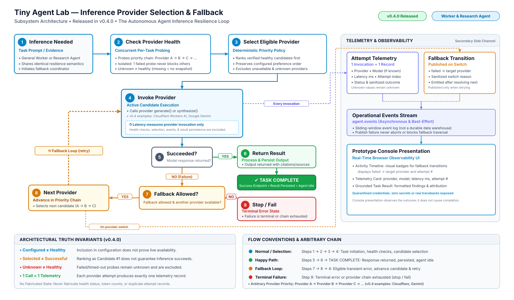

# Tiny Agent Lab Architecture Handbook #1: Provider Selection, Fallback, and Inference Telemetry

> **Subsystem Architecture Specification • Release v0.4.0 (V4 Reference Baseline)**
> *Baseline: Released Runtime Behavior (Git tag `v0.4.0` / Commit `62ca661`)*

---

## Architectural Question Answered

> **"What happens from the moment a Worker or Research Agent needs inference until a successful result or terminal provider failure is produced, including provider selection, fallback traversal, attempt telemetry, and Prototype Console observability?"**

This document and its accompanying standalone vector diagram detail the inner lifecycle of inference resilience in Tiny Agent Lab. Sitting one level below the high-level platform architecture, this specification focuses on how autonomous agents dynamically probe, rank, invoke, measure, and gracefully fall back across an arbitrary chain of AI inference providers without single-provider fragility or hardcoded vendor assumptions.

---

## Authoritative Architecture Diagram (V4)

The standalone vector diagram below illustrates the numbered primary flow, the explicit `TASK COMPLETE` success endpoint, the fallback retry loop, and parallel operational telemetry streams:



*Direct SVG link:* [`inference-provider-flow.svg`](inference-provider-flow.svg)

---

## Primary Execution Grammar (The Main Story)

The core architecture follows a single dominant numbered execution grammar that reads naturally from the upper-left toward the result:

```
1. Inference Needed
        ↓
2. Check Provider Health
        ↓
3. Select Eligible Provider ──[0 eligible: no invocation]──┐
        ↓ (eligible ≥ 1)                                   │
4. Invoke Provider                                         │
        ↓                                                  │
5. Succeeded?                                              │
    ↙           ↘                                          │
 YES             NO                                        │
  ↓               ↓                                        │
6. Return Result   7. Fallback Allowed?                    │
  ↓                  ↙             ↘                       │
TASK COMPLETE       YES             NO                     │
                     ↓               ↓                     │
                8. Next Provider   9. Stop / Fail ◄────────┘
                     │
                     └──────────────↺ 4. Invoke Provider
```

### Step 1: Inference Needed (Agent)
- **Shared Workflow**: General Worker and Research Agent share probing, deterministic selection, and fallback loop traversal. Worker inference generates direct completions (`provider.generate()`), while Research Agent inference conditions synthesis on retrieved research evidence (`provider.synthesize()`). The services do not have identical end-to-end resilience semantics, differing in post-failure state retention and task result schemas.
- **Initiation**: The agent receives a task from the transport queue (`TaskRequested`: `task_id`, `prompt`).
- **Coordinator Lifecycle**: `WorkerFallbackCoordinator` or `ResearchFallbackCoordinator` initializes per-task execution.

### Step 2: Check Provider Health (Selection)
- **Configured Priority Chain**: Providers are configured in ordered priority: `Provider A → Provider B → Provider C → ...` (e.g., `cloudflare,gemini`). Configured providers are validated and instantiated once at service startup without performing network pings or inference calls.
- **Concurrent Per-Task Probing**: Before selecting a provider for a task, the coordinator executes `check_health()` concurrently across all configured providers using `asyncio.gather(*probes, return_exceptions=True)`.
- **Failure Isolation**: Each probe is bounded by an outer timeout. If one provider probe times out or crashes, remaining probes continue unaffected.
- **Truthful Snapshots**: Probes return point-in-time `InferenceProviderHealth` snapshots. A failed or timed-out probe produces **no snapshot**; missing health is treated as unknown. **The system never assumes or fabricates a healthy state.**

### Step 3: Select Eligible Provider (Selection)
- **Deterministic Priority Policy**: `DeterministicProviderSelector` evaluates configured preferences and authentic health snapshots using `SelectionStrategy.PRIORITY`.
- **Ranking Invariants**: All verified `HEALTHY` candidates rank ahead of `DEGRADED` candidates; configured priority determines candidate order within the same health class.
- **Exclusion**: Constrained (`RATE_LIMITED` / `QUOTA_EXHAUSTED`), `UNAVAILABLE`, and missing-health candidates are strictly excluded.
- **Outcome & Zero-Candidate Path**: Produces an immutable, ordered candidate sequence for traversal. If no configured provider is eligible after selection, execution terminates immediately (advancing directly to Step 9 / failure) without performing any provider invocation; consequently, no attempt telemetry is created for an invocation that never occurred.

### Step 4: Invoke Provider (Execution)
- **Active Candidate Invocation**: The coordinator attempts inference against the current candidate.
- **Lazy Resolution**: Provider adapters are resolved lazily on demand (`resolver(candidate.provider_name)`) only when reached. Target providers are resolved exactly once.
- **Examples in v0.4.0**: Cloudflare Workers AI and Google Gemini serve as concrete production adapters. Stubs and mock providers support deterministic unit testing.

### Step 5: Succeeded? (Decision)
- **Verification**: Evaluates whether the model returned a valid, complete inference response.
- **Branch YES**: Advances directly to **Step 6 (Return Result)**.
- **Branch NO**: Evaluates failure cause and advances to **Step 7 (Fallback Allowed?)**.

### Step 6: Return Result & TASK COMPLETE (Success Path)
- **Output Processing**: Normalizes response text and metadata.
- **Persistence**: The agent constructs and persists a result payload to the `ResultStore`. General Worker persists a `TaskResult` containing text output (without source citations); Research Agent persists a `ResearchResult` preserving structured source attributions when research evidence was retrieved.
- **Explicit Success Endpoint (`TASK COMPLETE`)**: Execution reaches an unmistakable terminal destination. The task is fully complete, the result is saved, and the agent state transitions from `working` to `idle`.

### Step 7: Fallback Allowed? (Decision)
- **Eligibility Evaluation**: Determines whether execution may proceed to an alternative provider:
  1. Is the failure transient and provider-specific (e.g., rate limit, timeout, server outage, malformed response)?
  2. Does another candidate provider remain in the prioritized list?
- **Branch YES**: Advances to **Step 8 (Next Provider)**.
- **Branch NO**: Advances to **Step 9 (Stop / Fail)**.

### Step 8: Next Provider (Fallback Loop)
- **Candidate Advancement**: Selects the next eligible candidate in the ranked candidate chain (ordered by health tier, then configured priority).
- **Audit Event**: Emits a `FallbackTransition` operational event recording the switch reason and target provider after resolving the next candidate.
- **Loopback Execution**: Curves directly back into **Step 4 (Invoke Provider)** to attempt inference with the newly resolved provider.

### Step 9: Stop / Fail (Terminal Failure)
- **Execution Halt**: Traversal immediately terminates without further retries.
- **Terminal Error State**: Occurs when failure is permanent (non-fallback client error, invalid credentials, policy/safety block), when all candidate providers in the chain have been exhausted, or when zero eligible candidates exist after initial health selection.
- **Error Preservation**: The original underlying exception is preserved and re-raised (`TaskExecutionError` or `ResearchExecutionError`).
- **Post-Failure Agent State**: The agent publishes an `error` state event with failure details. Services differ in post-failure state handling: General Worker publishes an `idle` event immediately after the error event so the worker can accept subsequent tasks, whereas Research Agent retains the `error` state without an immediate transition back to `idle`.

---

## Semantic Failure Taxonomy

Runtime failures are classified into four semantic categories:

| Category | Typical Conditions | Traversal Action | Telemetry Status |
| :--- | :--- | :--- | :--- |
| **Eligible for Fallback** (`FallbackEligibleInferenceError`) | HTTP 429 rate limit, HTTP 500-599 server error, connection drop, network timeout, malformed provider payload. | Records sanitized `ProviderFailureSummary`. If candidates remain, resolves next provider, emits `FallbackTransition`, and retries. | `fallback_eligible_failure` |
| **Not Eligible for Fallback** (`NonFallbackInferenceError`) | HTTP 400 bad request, HTTP 401/403 authentication/authorization error, HTTP 404 endpoint not found, content safety block. | Traversal stops immediately. Falling back would be invalid or unsafe. Preserves and re-raises original error. | `non_fallback_failure` |
| **Unexpected Failure** (`Exception`) | Unhandled runtime crash, process error, memory error, or unmapped exception. | Traversal stops immediately. Preserves and re-raises original exception with `failure_reason="unexpected_error"`. | `unexpected_failure` |
| **Provider Exhaustion** (`AllInferenceProvidersFailedError`) | All ranked candidate providers failed with fallback-eligible errors. | Raises `AllInferenceProvidersFailedError(failures=(...))` containing the immutable tuple of sanitized summaries. **No duplicate terminal telemetry is emitted.** | *(All attempted providers already emitted telemetry)* |

---

## Telemetry & Observability (Parallel Secondary Streams)

Operational telemetry is a secondary side channel watching execution. Attempt telemetry and fallback transitions are **parallel tributaries**, not a sequential pipeline:

```
[ Step 4: Provider Attempt ]                 [ Step 8: Next Provider ]
             │                                            │
             │ (Every invocation)                         │ (On provider switch)
             ▼                                            ▼
   [ Attempt Telemetry ]                        [ Fallback Transition ]
             │                                            │
             └─────────────────────┬──────────────────────┘
                                   ▼
                       [ agent.events Stream ]
                                   │
                                   ▼
                       [ Prototype Console ]
```

### 1. Attempt Telemetry (`InferenceExecutionTelemetry`)
- **Principle**: *"One actual provider invocation = one attempt telemetry record."*
- **Origin**: Connects directly from **Step 4 (Invoke Provider)** on every attempt.
- **Fields Captured**:
  - Authoritative provider name;
  - Zero-based attempt index (`0, 1, ...`);
  - High-precision execution latency in milliseconds;
  - Execution status (`succeeded`, `fallback_eligible_failure`, `non_fallback_failure`, `unexpected_failure`);
  - Model name and finish reason (when genuinely returned);
  - Token usage: `input_tokens`, `output_tokens`, `total_tokens` (when reported by the upstream provider; unknown fields remain `None`, never estimated or fabricated);
  - Sanitized failure reason and HTTP status code on failures.

### 2. Fallback Transition Events (`FallbackTransition`)
- **Origin**: Connects directly from **Step 8 (Next Provider)**.
- **Semantics**: Emitted strictly when execution actually advances from a failed provider to a target provider.
- **Sequencing**: Published strictly *after* the next candidate provider has been successfully resolved.
- **Fields Captured**: `failed_provider`, `target_provider`, sanitized `reason`, and `attempt_index`.

### 3. Operational Stream & Prototype Console
- **Inline Awaited Event Publication**: Both tributaries construct `AgentEvent` envelopes and publish them over Redis to `agent.events`. Telemetry and fallback-transition notification callbacks are awaited inline by the coordinator rather than run as detached background tasks. Callback errors are caught and contained so event publishing failures do not abort ongoing fallback traversal.
- **Bounded Retention**: `agent.events` acts as a sliding-window operational audit stream (capped at approximately 500 entries) for live observability, not a permanent analytics warehouse.
- **Prototype Console Observability & Distinct Retrieval Paths**:
  - **Distinct Data Retrieval Paths**: The Prototype Console retrieves task outcomes from persistent result storage via `GET /api/tasks/{task_id}/result`, successful inference metadata via dedicated task-scoped query `GET /api/tasks/{task_id}/telemetry`, and timeline activity via the general sliding-window event feed `GET /api/events`.
  - **Live Activity Timeline**: Visual badges display `failed_provider → target_provider` switches, sanitized reasons, and 1-based attempt index parsed from `FallbackTransition` event payloads.
  - **Telemetry Card**: Displays execution latency (ms), provider name, model name, and 1-based attempt index retrieved from the task-scoped telemetry query for the successful attempt.
  - **Task Results**: Formatted output text loaded from the result store API (not from the event stream); citation links and source attributions are presented only where supported (e.g. grounded research tasks).
  - **Credential Security**: Tokens, API keys, private endpoints, and raw tracebacks are strictly quarantined on the server side and never sent to the browser.
  - **Execution Semantics**: Prototype Console observes task completion; it does not cause or gate task completion.

---

## Latency Measurement Boundary

> **Latency measures raw provider invocation time only.**

The measurement boundary wraps strictly around the provider network call:

```python
t_start = self._clock()  # time.perf_counter_ns
try:
    response = await current_provider.generate(prompt)
finally:
    t_end = self._clock()
latency_ms = max(0.0, (t_end - t_start) / 1_000_000.0)
```

### What Latency INCLUDES
- Network transit time to the upstream provider endpoint;
- Remote model inference and response token generation;
- Response payload reception and deserialization.

### What Latency STRICTLY EXCLUDES
- Service startup validation and provider instantiation;
- Concurrent per-task health probes (`check_health()`);
- Policy selection and candidate ranking;
- Provider instance resolution (`resolver(candidate.provider_name)`);
- `FallbackTransition` event construction and bus dispatch;
- `InferenceExecutionTelemetry` construction and Redis stream publication;
- Result store database operations or file writes.

---

## Architectural Truth Invariants

Tiny Agent Lab enforces four core truthfulness rules:

1. **`Configured ≠ Healthy`**: Static presence in `INFERENCE_PROVIDER` proves only that credentials or configurations were syntactically present at startup. It does not indicate that the remote endpoint is reachable or healthy at execution time.
2. **`Selected ≠ Successful`**: Being ranked as Candidate #1 by policy does not guarantee that inference will succeed. Live network errors, upstream capacity drops, and rate limits can occur immediately after selection.
3. **`Unknown ≠ Healthy`**: A provider whose health probe times out, throws an exception, or fails to connect produces no health snapshot. Missing health is treated as unknown and excluded from selection; missing snapshots are never treated as healthy. Coordinator-level probe timeouts or unhandled exceptions yield no snapshot and remain unknown; provider adapters may return explicit `UNAVAILABLE` snapshots.
4. **`1 Provider Invocation = 1 Telemetry Record`**: Telemetry is emitted on every actual attempt. If a provider is not invoked (e.g., when zero eligible candidates exist), zero telemetry is emitted for it. When candidate exhaustion occurs, every attempted provider already has its own attempt record; no synthetic or duplicate terminal attempt telemetry is created.
5. **No Fabricated State**: Token counts, health status, and failure summaries are never invented or guessed. Unknown values remain explicitly unknown.

---

## Release v0.4.0 Deployment Validation (home-core Baseline)

### Deployment Target & Environment
- **Host**: `home-core` (bare-metal home server).
- **Deployment**: Docker Compose (`compose.yaml`).
- **Deployed Branch**: `main` (Release `v0.4.0`).
- **Prototype Console**: Visibly identifies `v0.4.0`.
- **Configured External Providers**:
  - **Inference**: Cloudflare Workers AI only (`INFERENCE_PROVIDER=cloudflare`, model `@cf/meta/llama-3.1-8b-instruct`).
  - **Research Retrieval**: Tavily Search API (`RESEARCH_EXECUTOR=tavily`).
  - **Failure Isolation**: No stub or secondary inference provider was added to mask failures; Cloudflare operated as the single production inference provider under live evaluation.

### Operational Validation Completed

#### 1. General Worker
- **Task Routing**: Correctly routed incoming `GENERAL` tasks to the General Worker (`worker-1`).
- **Health & Selection**: Cloudflare health probe evaluated the configured model alias and remained the single eligible inference provider (`DEGRADED` status preserving execution eligibility).
- **Inference Execution**: Three consecutive General Worker inference tasks completed successfully end-to-end.
- **Observed Inference Latencies (Raw Provider Boundary)**:
  - Task 1: `809.0 ms`
  - Task 2: `921.4 ms`
  - Task 3: `717.8 ms`
- **Telemetry Presentation**: Successful attempt telemetry was emitted to `agent.events` and presented in the Prototype Console telemetry card.
- **Attempt Tracking**: Each successful run was attempt 1 (`attempt_index=0`, displayed as attempt 1).
- **Fallback Verification**: Zero fallback transitions occurred, as primary inference succeeded on the first attempt.
- **Lifecycle Cleanliness**: General Worker transitioned cleanly from `working` back to `idle` after each task completion.

#### 2. Research Agent
- **Task Routing**: Correctly routed an incoming natural-language `RESEARCH` task to the specialized Research Agent (`research-agent-1`).
- **Grounded Retrieval**: Tavily search executed successfully, retrieving relevant public web evidence.
- **Synthesis Execution**: Cloudflare synthesis completed successfully with evidence conditioning.
- **Observed Synthesis Latency (Raw Provider Boundary)**: `2764.0 ms`.
- **Attempt Tracking**: Completed on attempt 1.
- **Result Presentation**: Grounded research findings with structured numbered findings and clickable source citations were persisted to `ResultStore` and presented in the Prototype Console.
- **Lifecycle Cleanliness**: Research Agent returned cleanly to `idle` upon task completion.

### Validation Boundary (Initial Single-Provider Baseline)
- **Initial Single-Provider Configuration**: Cloudflare Workers AI was intentionally the only configured inference provider during this initial baseline deployment exercise.
- **Demonstrated Scope of Initial Baseline**: This initial baseline proved the single-provider selection, execution, telemetry, General Worker, and Research Agent operational paths.
- **Subsequent Fallback Validation**: Live cross-provider fallback traversal—initially unexercised in this baseline run—was subsequently validated on `home-core` using a controlled multi-provider configuration (`gemini,cloudflare`), as documented in [Live Cross-Provider Fallback Validation](#live-cross-provider-fallback-validation-home-core-post-release).

### Deployment Defects Discovered and Resolved

Live deployment on `home-core` surfaced real integration defects that were isolated, resolved, and verified during post-release deployment validation:

1. **Issue #153 / PR #154 — Container Policy Dependency Packaging**:
   - **Defect**: Agent runtime containers omitted `packages/policy/src` and `/app/policy`, causing runtime crash:
     ```
     ModuleNotFoundError: No module named 'agent_policy'
     ```
   - **Resolution**: Packaged policy dependency in Worker and Research Agent Docker images (`Dockerfile`), configured `PYTHONPATH`, and added container-boundary CI validation in `.github/workflows/ci.yml`.

2. **Issue #155 / PR #156 — False-Negative Cloudflare Model Health Classification**:
   - **Defect**: For configured model `@cf/meta/llama-3.1-8b-instruct`, Cloudflare catalog search returned only `@cf/meta/llama-3.1-8b-instruct-fp8` (with UUID id), while schema lookup for the base alias returned HTTP 404 / code 6002 (`Model schema not found`). Schema lookup for the FP8 variant succeeded, and direct inference against the configured base alias succeeded (HTTP 200). The probe previously classified the model as `UNAVAILABLE` due to the lack of exact catalog metadata.
   - **Resolution**: Retained strict exact model matching (never treating related variants like `-fp8` as equivalent to the configured model). Exact catalog or schema confirmation reports `HEALTHY`. Authenticated and reachable but metadata-unverified executable aliases report `DEGRADED` (`is_available=True`), truthfully reflecting unverified metadata while preserving runtime execution eligibility.

3. **Issue #157 / PR #158 — Configurable Health Probe Timeout**:
   - **Defect**: Cloudflare's two-stage zero-generation probe (catalog search + schema lookup) took 0.620s–0.827s in live measurements. Normal network variance occasionally exceeded the hardcoded 1.0-second coordinator timeout:
     ```
     Health probe timed out for provider cloudflare (timeout=1.00s)
     ```
     This cancelled the probe before it could return the intended `DEGRADED`-but-eligible snapshot, resulting in zero eligible providers.
   - **Resolution**: Introduced unified `HEALTH_PROBE_TIMEOUT_SECONDS` configuration with a realistic 3.0s default across Worker and Research Agent, strict finite positive validation, explicit coordinator wiring, and preserved concurrent multi-provider probing.

### Deployment Testing Lessons
- **Validation Layers**: `pytest` and `Ruff` remained necessary validation layers for contract compliance, pure policy invariants, and deterministic simulation.
- **Runtime Boundary Gaps**: The previously green host-based tests and lint suites did not initially exercise every runtime and environment boundary encountered on `home-core`.
- **Three Discovered Gap Classes**: Deployment validation exposed three distinct classes of gaps:
  1. *Container Packaging*: Host tests ran against the local development environment without validating container-image filesystem structures (`PYTHONPATH` and copied package roots).
  2. *Real External-Provider Metadata Behavior*: Test doubles could not anticipate Cloudflare's runtime model aliasing where direct generation succeeds but catalog and schema endpoints return variant names or 404 responses.
  3. *Network-Sensitive Timeout Assumptions*: Local and mock execution did not reflect the real-world network latency and multi-endpoint overhead of remote provider metadata probing under network variance.
- **Continuous Improvement**: Container-boundary CI coverage was added for the packaging defect, and these empirical findings should inform the subsequent test-strategy review without disparaging `pytest`, `Ruff`, mocks, or automated testing generally. For comprehensive definitions and release validation procedures across all seven testing layers, see the authoritative [Testing Strategy](../testing-strategy.md).

---

## Live Cross-Provider Fallback Validation (home-core Post-Release)

Following the initial single-provider deployment validation, live cross-provider fallback traversal was operationally validated on the physical `home-core` server.

### Validation Context & Configuration
- **Host**: `home-core` (bare-metal physical host).
- **Commit**: `8e9fe54` (`fix: allow fallback on Gemini payment required (#166)`).
- **Deployment**: Docker Compose (`compose.yaml`).
- **Configured Providers**:
  - `INFERENCE_PROVIDER=gemini,cloudflare`
  - `GEMINI_MODEL=gemini-3.8-flash`
- **Controlled Failure Mechanism**: The Gemini API key belonged to an existing Google Cloud Tier 1 project with depleted prepaid balance (exhausted credits). This was an intentional, temporary validation configuration chosen specifically to produce a genuine remote `HTTP 402 Payment Required` inference-time failure while the zero-generation metadata probe succeeded.
- **Model Note**: The validation deliberately used `gemini-3.8-flash` with the depleted Tier 1 project because that specific combination produced the genuine payment-required condition. Issue #165 separately updates the repository default model to `gemini-3.5-flash-lite`. Historical records truthfully document the exact model used during validation.

### Live General Worker Execution Evidence

- **Primary Task ID**: `238c6784-e43c-4194-b8cc-943028c7f56f`
- **Provider Probing Phase**:
  - Gemini metadata probe: `GET /v1beta/models/gemini-3.8-flash` returned `HTTP 200 OK` (status `HEALTHY`).
  - Cloudflare metadata probe completed successfully and Cloudflare remained eligible (`DEGRADED` status preserving execution eligibility).
- **Runtime Traversal & Execution**:
  1. **Primary Selection**: Gemini was selected first according to the configured priority chain (`gemini,cloudflare`).
  2. **Primary Execution Failure**: Real Gemini `generateContent` request returned `HTTP 402 Payment Required`.
  3. **Failure Classification**: The Gemini transport client classified the failure as a fallback-eligible error:
     - `provider_name`: `gemini`
     - `status`: `fallback_eligible_failure`
     - `failure_reason`: `payment_required`
     - `status_code`: `402`
     - `attempt_index`: `0`
     - `measured latency`: `501.890075 ms`
  4. **Fallback Transition**: A real `FallbackTransition` event was emitted to `agent.events`:
     - `failed_provider`: `gemini`
     - `selected_provider`: `cloudflare`
     - `reason`: `payment_required`
     - `attempt_index`: `0`
  5. **Secondary Invocation**: Cloudflare Workers AI was invoked as the secondary candidate in the priority chain.
  6. **Secondary Execution Success**: Real Cloudflare Workers AI inference returned `HTTP 200 OK`.
  7. **Secondary Attempt Telemetry**: Successful execution telemetry was emitted to `agent.events`:
     - `provider_name`: `cloudflare`
     - `status`: `succeeded`
     - `attempt_index`: `1`
     - `latency`: `816.675519 ms`
     - `input_tokens`: `68`
     - `output_tokens`: `18`
     - `total_tokens`: `86`
     - `model_name`: `@cf/meta/llama-3.1-8b-instruct`
  8. **Worker Lifecycle**: General Worker transitioned cleanly from `working` back to `idle` upon task completion.

### Persistence & Operator Visibility Evidence

- **Redis Task Result**: The task result was persisted to Redis `ResultStore` as completed and acknowledged.
- **Redis Event Stream**: Event history independently preserved:
  - Gemini failed-attempt telemetry (`status="fallback_eligible_failure"`, `failure_reason="payment_required"`, `status_code=402`)
  - Gemini → Cloudflare fallback transition (`reason="payment_required"`)
  - Cloudflare successful-attempt telemetry (`status="succeeded"`, attempt 1)
  - Final Worker `idle` completion event
- **Prototype Console Visibility**: The Prototype Console UI visibly displayed the fallback transition and secondary Cloudflare success.
- **Repeatability**: A second controlled General task verified identical traversal:
  - Gemini → Cloudflare transition
  - `reason`: `payment_required`
  - Cloudflare execution on attempt 2
  - Successful task completion and acknowledgment
- **Assertion Boundary**: No claims are made about exact model instruction-following behavior from the specific generated text. The purpose of these runs was operational validation of provider traversal, per-attempt telemetry, event stream persistence, and fallback coordination under live conditions.

### Proven Scope and Validation Boundary

- **What Is Proven**:
  ```
  Gemini metadata HEALTHY
  -> real Gemini HTTP 402 during generation
  -> payment_required failure telemetry
  -> fallback-transition event
  -> real Cloudflare invocation
  -> Cloudflare HTTP 200
  -> secondary-attempt success telemetry
  -> completed persisted result
  -> Worker returned to idle
  ```
  This proves real cross-provider traversal for a fallback-eligible provider execution failure under genuine multi-provider operation.
- **Explicit Limitations**:
  - Live fallback has now been operationally demonstrated on `home-core` for the `payment_required` failure class across a two-provider chain (`gemini → cloudflare`).
  - This does **NOT** generalize into proof that every provider failure class (e.g., rate limits, upstream 5xx outages, transport timeouts) or every provider ordering (e.g., `cloudflare → gemini` or 3+ providers) has been live-tested on deployment hosts.
