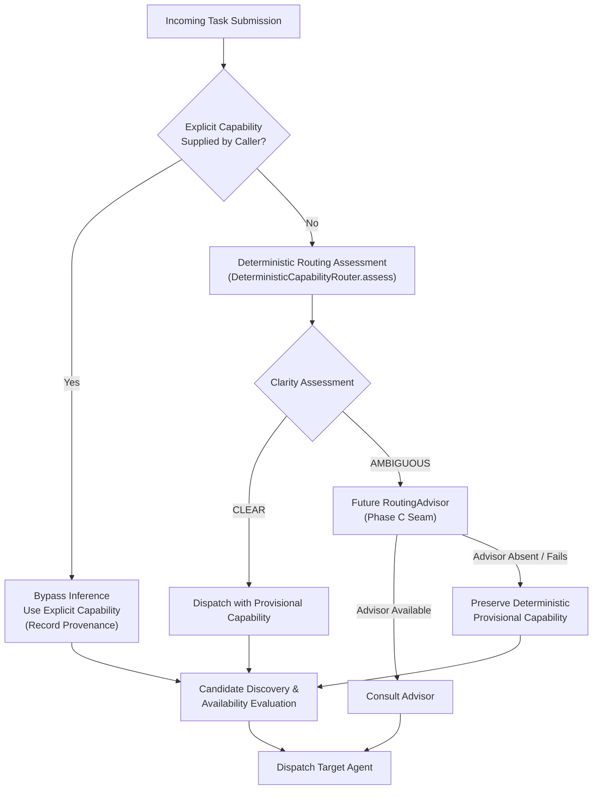

# Routing Evaluation, Deterministic Assessment & Hybrid Advisory Architecture

This document describes the routing evaluation dataset, benchmark runner, empirical baseline, Phase B deterministic assessment architecture, and the Phase C1 provider-neutral hybrid advisory architecture established for the capability routing subsystem in `autonomous-agent-lab`.

---

## 1. Purpose

The capability router directs incoming task prompts to the appropriate specialized agent (such as `AgentCapability.GENERAL` or `AgentCapability.RESEARCH`). 

As the platform evaluates potential improvements to capability routing (GitHub issue #91), an empirical baseline and typed assessment architecture are required to:
- Objectively quantify routing accuracy, precision, recall, and false-positive rates against ground truth.
- Evolve routing from returning a bare capability enum into producing a transparent [`RoutingAssessment`](../services/orchestrator/src/orchestrator/domain/assessment.py).
- Distinguish between **CLEAR** and **AMBIGUOUS** deterministic signals without relying on uncalibrated numeric confidence scores.
- Establish an architectural seam for a future `RoutingAdvisor` that is consulted only when deterministic evidence is ambiguous.
- Preserve backward-compatible `route(prompt) -> AgentCapability` execution across the system.

---

## 2. Dataset Architecture: Development vs. Development-Adjacent Validation

Routing evaluation is separated into two version-controlled datasets to distinguish development iteration from regression and adversarial coverage:

1. **Development Dataset** ([`evaluation/routing/dataset.json`](../evaluation/routing/dataset.json)): 44 curated test cases across 9 categories used to define and evaluate initial baseline signals. A 100% score on this dataset indicates that all known development cases pass, not universal production accuracy.
2. **Validation Dataset** ([`evaluation/routing/validation_dataset.json`](../evaluation/routing/validation_dataset.json)): 34 diverse test cases and adversarial prompts created during the same implementation cycle. This dataset provides regression and adversarial coverage for weak-verb disambiguation, diagnostic artifacts, and edge cases.

> [!IMPORTANT]
> Development-set and validation-set metrics are always reported separately.
> - The 44-case dataset is the primary development dataset.
> - The 34-case validation dataset was created during the same implementation cycle; its results provide regression and adversarial coverage rather than an unbiased production-accuracy estimate.
> - An unbiased production-accuracy estimate requires a future independent lockbox dataset created independently after the implementation is frozen.

### Schema

```json
{
  "id": "eval-001",
  "prompt": "What is 15% of 850?",
  "expected_capability": "general",
  "clarity": "clear",
  "rationale": "Direct arithmetic computation that does not require external evidence or live web retrieval.",
  "category": "clear_general",
  "tags": ["math", "calculation", "deterministic"]
}
```

| Field | Type | Description |
|---|---|---|
| `id` | `string` | Unique identifier (e.g., `eval-001` or `val-001`). |
| `prompt` | `string` | The task instruction presented to the router (including short inline artifacts where applicable). |
| `expected_capability` | `"general" \| "research"` | Ground-truth capability required to complete the task. |
| `clarity` | `"clear" \| "ambiguous"` | Whether the intent is unequivocally clear or a borderline/mixed-intent case. |
| `rationale` | `string` | Architectural justification for the assigned ground truth label. |
| `category` | `string` | The functional evaluation category. |
| `tags` | `list[string]` | Keywords indexing prompt characteristics. |

### Categories Covered Across Datasets

- **Development Dataset (44 cases)**: `clear_general`, `clear_research`, `ambiguous_borderline`, `freshness_current_info`, `explicit_sources_evidence`, `explanatory_general`, `code_transformation`, `multi_clause_mixed`, `research_keywords_negative`.
- **Validation Dataset (34 cases)**: `weak_verb_supplied_artifact`, `freshness_current_info`, `supported_versions_compatibility`, `changing_prices_availability`, `external_standards_guidance`, `historical_established_advances`, `negative_current_program_state`, `negative_current_electrical`, `vague_insufficient_evidence`, `mixed_supplied_and_external`, `compound_retrieval_prerequisite`, `weak_verb_alone`, `package_management_installation`, `personal_activity_temporal`, `diagnostic_evidence_supplied_artifact`, `volatile_demographic_freshness`.

---

## 3. Ground Truth Labeling Principles

### Independence from Router Implementations
Ground truth labels represent **human architectural intent**, not the behavior of any existing router. An expected label must never be assigned simply because an existing regular expression or keyword list triggers on it.

### Evaluation Criteria
A prompt is labeled `expected_capability: "research"` if and only if:
- It requires up-to-date, live, or changing information past standard model training cutoffs (e.g., current pricing, recent releases, breaking news).
- It explicitly demands external source retrieval, URL citations, whitepapers, or peer-reviewed literature.
- Completing the task accurately depends on querying external search engines or verification tools.

A prompt is labeled `expected_capability: "general"` if:
- It asks for code synthesis, refactoring, formatting, debugging, or transformation of user-supplied code or inline artifacts.
- It asks for established concepts, definitions, mathematical calculations, or textbook algorithms.
- It uses words like "analyze", "compare", or "benchmark" to describe a local calculation or code analysis on user-supplied input.

### Criteria for Clear vs. Ambiguous
- **`clear`**: Intent is unambiguous. Any experienced software engineer would classify the required agent capability identically without needing further context.
- **`ambiguous`**: The prompt combines mixed signals, lacks temporal context, or could be answered adequately by either general synthesis or live retrieval depending on user expectations. For example, in `eval-013` (*"Tell me about quantum computing advancements"*), both a general historical overview and a current research interpretation are plausible; assigning `expected_capability: "research"` is a deliberate Tiny Robot policy choice for an ambiguous prompt to prioritize recent developments.

---

## 4. Phase B: Deterministic Routing Assessment Architecture

Phase B transitions the capability router from returning a flat `AgentCapability` enum to producing an immutable, inspectable [`RoutingAssessment`](../services/orchestrator/src/orchestrator/domain/assessment.py).

### Domain Model

```python
@dataclass(frozen=True)
class RoutingAssessment:
    provisional_capability: AgentCapability
    clarity: RoutingClarity
    signals: tuple[RoutingSignal, ...]
    reason: str
```

### Routing Authority Order



1. **Caller-Supplied Explicit Capability**: An explicit capability override is always authoritative. It bypasses deterministic inference and any advisor, while strictly preserving candidate discovery, availability checks, selection, and transport dispatch.
2. **Deterministic Routing**: The primary inference mechanism. Evaluates typed signals at microsecond speed. When assessment clarity is `CLEAR`, the provisional capability is immediately resolved without calling any advisor.
3. **RoutingAdvisor (Phase C1 Seam)**: Consulted **only** when assessment clarity is `AMBIGUOUS`. Advisory only.
4. **Resilient Fallback**: If an advisor is absent, times out, or fails, the orchestrator preserves the deterministic provisional capability rather than failing or unprincipled fallback.

---

## 5. Phase C1: Provider-Neutral RoutingAdvisor and Hybrid Routing Policy

Phase C1 introduces a provider-neutral application boundary through which an optional routing advisor may recommend a capability for prompts where deterministic analysis is ambiguous.

### Boundary & Contracts

- **Protocol**: [`RoutingAdvisor`](../services/orchestrator/src/orchestrator/application/ports.py) in orchestrator application layer:
  ```python
  @runtime_checkable
  class RoutingAdvisor(Protocol):
      async def advise(
          self, prompt: str, assessment: RoutingAssessment
      ) -> AdvisorRecommendation: ...
  ```
- **Contract**: [`AdvisorRecommendation`](../services/orchestrator/src/orchestrator/domain/advisor.py) in domain layer:
  ```python
  @dataclass(frozen=True)
  class AdvisorRecommendation:
      recommended_capability: AgentCapability
      reason: str
  ```
  - `recommended_capability` must be an `AgentCapability` instance.
  - `reason` must be a non-empty string.
  - Strict anti-corruption validation prevents the advisor from returning agent identity patterns (e.g. `worker-`, `research-agent-`), dispatch targets (`agent.tasks.`, `tasks.`), or execution commands (`dispatch to`, `execute on`).
- **Exception Hierarchy**:
  - `AdvisorError(Exception)`
  - `AdvisorUnavailableError(AdvisorError)`
  - `AdvisorTimeoutError(AdvisorError)`
  - `AdvisorExecutionError(AdvisorError)`

### Strict Hierarchy of Authority

1. **Explicit Caller Capability Override**: Absolute authority. Bypasses deterministic assessment and advisor entirely.
2. **Deterministic RoutingAssessment**: Always runs when no override is present. If `clarity == RoutingClarity.CLEAR`, the orchestrator immediately resolves to `provisional_capability`. The advisor is never consulted.
3. **RoutingAdvisor**: Consulted ONLY when deterministic assessment is `RoutingClarity.AMBIGUOUS`. The advisor is strictly advisory—it recommends a capability, but cannot select agents or dictate dispatch targets.
4. **Deterministic Provisional Fallback**: If the advisor is not configured, unavailable, or times out, the orchestrator falls back to `provisional_capability`.

### Failure Model

- **Expected Provider Failures**: `AdvisorUnavailableError`, `AdvisorTimeoutError`, `AdvisorExecutionError`, and `TimeoutError` are caught gracefully. The orchestrator logs the fallback in provenance and resolves to the deterministic `provisional_capability`.
- **Contract Violations**: If an advisor returns an invalid object (not an `AdvisorRecommendation`), `SubmitTask` raises `TypeError` immediately (fail loudly), preventing corrupted data from polluting the routing pipeline.

### Decision Provenance

[`RoutingProvenance`](../packages/contracts/src/agent_contracts/routing.py) is persisted as part of every [`RoutingDecision`](../packages/contracts/src/agent_contracts/routing.py), answering:
1. `is_explicit_override: bool` — Was an explicit caller capability override provided?
2. `assessment_clarity: str | None` — Was deterministic clarity `"clear"` or `"ambiguous"`?
3. `provisional_capability: str | None` — What was the deterministic provisional capability?
4. `advisor_consulted: bool` — Was an external advisor consulted?
5. `advisor_verdict: str | None` — What was the advisor's action (`"agreed"`, `"changed"`, `"unavailable"`, `"timeout"`, `"failed"`, or `None`)?
6. `fallback_used: bool` — Did the orchestrator fall back to the provisional capability due to advisor failure?
7. `final_selection_reason: str` — What was the authoritative reason for the final capability?

### Scope & Provider Decoupling

Phase C1 introduces no Ollama, Cloudflare, local model, or network dependencies. Provider-specific implementations (e.g., Ollama adapter) are deferred to Phase C2, adhering to Clean Architecture principles.

### Plumbing Validation vs. Model-Quality Benchmarking

To verify the hybrid execution plumbing prior to introducing model providers (Phase C2), Phase C1 provides a deterministic test fixture: `SimulatedPlumbingAdvisor` in [`evaluation/routing/benchmark.py`](../evaluation/routing/benchmark.py).

`SimulatedPlumbingAdvisor` deterministically cycles through all hybrid plumbing branches for AMBIGUOUS assessments:
1. **Agreement** (step 0): Confirms the provisional capability.
2. **Override / Changed Recommendation** (step 1): Deliberately returns the opposite capability to verify that the orchestrator respects an advisor recommendation when it differs from the provisional assessment.
3. **Unavailable Fallback** (step 2): Raises `AdvisorUnavailableError` to verify fallback to the provisional capability.
4. **Timeout Fallback** (step 3): Raises `AdvisorTimeoutError` to verify fallback to the provisional capability.
5. **Execution Error Fallback** (step 4): Raises `AdvisorExecutionError` to verify fallback to the provisional capability.

> [!IMPORTANT]
> **Plumbing Verification is NOT Model-Quality Evidence**:
> The simulated advisor exists solely to verify wiring, fallback mechanics, and provenance logging. Because step 1 deliberately overrides the provisional capability, synthetic advisor overrides alter **final post-advisor routing accuracy** without retroactively altering **deterministic provisional capability accuracy**:
> - On the development dataset, case `eval-012` (*"What are the best practices for securing a REST API?"*) has expected capability `GENERAL`. The deterministic router provisionally selects `GENERAL` (100% correct). The simulated advisor deliberately changes it to `RESEARCH`, demonstrating that advisor overrides function as intended in dispatch decisions. This produces a final capability accuracy of 97.73% (43/44) while deterministic provisional accuracy remains 100.00% (44/44).
> - On the validation dataset, synthetic overrides on cases `val-022` and `val-029` similarly produce a final capability accuracy of 94.12% (32/34) while deterministic provisional accuracy remains 100.00% (34/34).

---

## 6. Signal Taxonomy & Core Routing Policies

### Signal Strength Tiers

| Signal Type | Target Capability | Strength | Description & Trigger Conditions |
|---|---|---|---|
| `EXPLICIT_SOURCES_OR_CITATIONS` | `RESEARCH` | `STRONG` | Explicit requests for literature, peer-reviewed studies, whitepapers, or source citations. |
| `FRESHNESS_OR_CURRENT_INFO` | `RESEARCH` | `STRONG` | Reusable temporal qualifiers (`today's`, `currently supported`, `latest release`, `current guidance`). |
| `CHANGING_EXTERNAL_INFO` | `RESEARCH` | `STRONG` | High-frequency changing information (`pricing tiers`, `stock market trends`, `breaking changes`). |
| `OUTSIDE_AUTHORITY_OR_PROVIDER` | `RESEARCH` | `STRONG` | Inquiries targeting specific external conferences, standards bodies (NIST, ISO), or vulnerability registries (NVD, CVE). |
| `EXPLICIT_EXTERNAL_RETRIEVAL` | `RESEARCH` | `STRONG` | Explicit directions to query live external search engines. |
| `SUPPLIED_LOCAL_ARTIFACT` | `GENERAL` | `STRONG` | Actual presence of structural markers (fenced code, diffs, stack traces, INI configs, JSON payloads). |
| `LOCAL_CODE_OR_DEBUGGING` | `GENERAL` | `STRONG` | Local coding/debugging tasks (`write a python script`, `fix this bug`, `loop termination analysis`). |
| `TRANSFORMATION_OR_REWRITE` | `GENERAL` | `STRONG` | Code or text transformations (`refactor this function`, `convert correlated subquery to CTE`). |
| `ESTABLISHED_CONCEPTUAL_EXPLANATION` | `GENERAL` | `STRONG` | Established computing theory, protocol mechanics, basic math, or physical science explanation. |
| `ALL_DATA_SUPPLIED_INLINE` | `GENERAL` | `STRONG` | Tasks where all necessary input data is provided inline. |
| `WEAK_RESEARCH_VERB` | `RESEARCH` | `WEAK` | Contextual verbs (`analyze`, `assess`, `compare`, `evaluate`, `benchmark`, `survey`, `conduct`, `research`, `investigate`, `study`, `explore`). |
| `COMPOUND_MIXED_TASK` | `RESEARCH` | `STRONG` | Multi-clause prompts combining external retrieval and local code synthesis. |

### Core Deterministic Policies

#### 1. Weak-Verb Policy
Weak research-like verbs (`analyze`, `assess`, `benchmark`, `compare`, `evaluate`, `survey`, `conduct`, `research`, `investigate`, `study`, `explore`) are contextual indicators and **must never independently determine RESEARCH**:
- **Weak verb + strong General evidence** -> `GENERAL / CLEAR` (e.g. *"Research this function and explain why the loop never terminates"*).
- **Weak verb + strong Research evidence** -> follows strong Research evidence (e.g. *"Research the latest developments in quantum computing"* -> `RESEARCH / CLEAR`).
- **Weak verb alone** -> provisional `GENERAL`, with clarity marked `AMBIGUOUS` (e.g. *"Research consensus algorithms"* -> `GENERAL / AMBIGUOUS`).
- The word "research" alone is never proof of external retrieval.

#### 2. Generalized Freshness & Negative Guards
Freshness is recognized when temporal qualifiers (`today`, `today's`, `current`, `currently`, `latest`, `recent`, `up-to-date`, `as of`) attach to volatile external facts (supported versions, releases, pricing, vulnerabilities, office holders, product capabilities, market conditions, standards or guidance).

**Negative Guards**: The word "current" does not trigger research when it refers to local program state (`current_user`, `current_node`, `current index`) or electrical current (`current of 10A`, `direct current`, `voltage drop given a current`).

#### 3. Generalized Supplied-Artifact Detection
`SUPPLIED_LOCAL_ARTIFACT` requires actual structural markers (fenced code blocks, stack traces, unified diffs, structured JSON/YAML/XML data, INI/TOML configuration blocks, or code constructs). Prompts merely containing words like "this" or "below" without actual content do not trigger artifact signals.

#### 4. Dynamic Reason Generation
Reasons are generated dynamically from the exact list of detected signals. Every reason accurately reflects the attached signals, never claims absent signals, and remains fully deterministic.

---

## 7. Benchmark Runner & CLI Options

The benchmark runner ([`evaluation/routing/benchmark.py`](../evaluation/routing/benchmark.py)) decouples correctness analysis from isolated latency profiling.

### Command-Line Interface

```bash
# 1. Run Phase B benchmark on the development dataset (Default)
PYTHONPATH="services/orchestrator/src:services/worker/src:services/research_agent/src:packages/contracts/src:." \
python -m evaluation.routing.benchmark

# 2. Run Phase B benchmark on the development-adjacent validation dataset
PYTHONPATH="services/orchestrator/src:services/worker/src:services/research_agent/src:packages/contracts/src:." \
python -m evaluation.routing.benchmark --validation

# 3. Run both development and validation datasets sequentially
PYTHONPATH="services/orchestrator/src:services/worker/src:services/research_agent/src:packages/contracts/src:." \
python -m evaluation.routing.benchmark --all

# 4. Reproduce frozen historical Routing v2 baseline (63.64%)
PYTHONPATH="services/orchestrator/src:services/worker/src:services/research_agent/src:packages/contracts/src:." \
python -m evaluation.routing.benchmark --baseline-v2

# 5. Validate simulated advisor plumbing on ambiguous cases
PYTHONPATH="services/orchestrator/src:services/worker/src:services/research_agent/src:packages/contracts/src:." \
python -m evaluation.routing.benchmark --simulate-advisor
```

---

## 8. Empirical Results & Performance Summary

### Comparative Performance Table

| Metric | Phase A: Routing v2 Baseline | Phase B: Development Dataset | Phase B: Validation Dataset | Phase C1: Simulated Advisor (Plumbing Test) |
|---|:---:|:---:|:---:|:---:|
| **Cases Evaluated** | 44 | 44 | 34 | 44 / 34 |
| **Provisional Capability Accuracy (Deterministic)** | **63.64%** (28/44) | **100.00%** (44/44) | **100.00%** (34/34) | **100.00%** (44/44) / **100.00%** (34/34) |
| **Final Capability Accuracy (Post-Advisor)** | **63.64%** (28/44) | **100.00%** (44/44) | **100.00%** (34/34) | **97.73%** (43/44) / **94.12%** (32/34) * |
| **Clarity Label Alignment** | 88.64% (39/44) | **100.00%** (44/44) | **100.00%** (34/34) | **100.00%** |
| **Advisor Delegation Rate** | 0.00% (0/44) | **11.36%** (5/44) | **23.53%** (8/34) | **11.36%** / **23.53%** |
| **Clear Prompt Advisor Invocations** | N/A | 0 (enforced) | 0 (enforced) | **0 (enforced)** |
| **Capability Acc (Assessed CLEAR)** | 63.64% | **100.00%** (39/39) | **100.00%** (26/26) | **100.00%** |
| **Capability Acc (Assessed AMBIGUOUS, Provisional)** | 0.00% | **100.00%** (5/5) | **100.00%** (8/8) | **100.00%** (5/5) / **100.00%** (8/8) |
| **Capability Acc (Assessed AMBIGUOUS, Final Post-Simulation)** | 0.00% | **100.00%** (5/5) | **100.00%** (8/8) | **80.00%** (4/5) / **75.00%** (6/8) * |
| **Research Precision / Recall / F1 (Final)** | 0.56 / 0.56 / 0.56 | **1.00 / 1.00 / 1.00** | **1.00 / 1.00 / 1.00** | **0.95 / 1.00 / 0.97** (dev) / **0.89 / 1.00 / 0.94** (val) |
| **General Precision / Recall / F1 (Final)** | 0.69 / 0.69 / 0.69 | **1.00 / 1.00 / 1.00** | **1.00 / 1.00 / 1.00** | **1.00 / 0.96 / 0.98** (dev) / **1.00 / 0.89 / 0.94** (val) |
| **Median Execution Latency (P50)** | **~50 µs** | **~110 µs** | **~100 µs** | **~130 µs** |

\* *Note on Phase C1 Final Accuracy: The simulated plumbing advisor intentionally exercises synthetic overrides on step 1 of its cycle (`eval-012` on dev; `val-022` and `val-029` on val) to prove that changed advisor recommendations alter the final dispatch decision. This validates plumbing mechanics, not model intelligence.*

---

## 9. Generalization Lessons & Phase C Prerequisites

### Generalization Lessons from Phase B
Initial testing of Phase B against unseen prompts revealed that high development scores can mask narrow regex assumptions:
1. Overly specific literal patterns (e.g. naming specific APIs or conferences) fail when users query different vendors or events.
2. Treating weak verbs like "research", "compare", or "assess" as authoritative research triggers causes severe false positives on local code debugging and configuration comparisons.
3. Matching "current" without negative guards misclassifies local variables (`current_user`, `current_node`) and electrical measurements as freshness research.
4. Unqualified temporal phrases like "this week" or "this month" misclassify personal user statements ("I started learning Rust this week") unless gated against personal activity.
5. "Find evidence" applied to supplied diagnostic artifacts (such as heap dumps or stack traces) represents local inspection rather than academic/literature retrieval.

### Deterministic Limits & Readiness for Phase C2
While the generalized deterministic rules achieve 100% on both the 44-case development set and the 34-case validation set, deterministic pattern matching has fundamental limits:
- Novel phrasings without explicit freshness keywords or structural cues may be classified as ambiguous.
- True natural language understanding is required to disambiguate subtle contextual trade-offs.

**Phase C2 (Ollama / Local LLM RoutingAdvisor Adapter)** should be explored because:
1. The provider-neutral application boundary and hybrid policy are established and thoroughly tested.
2. Validation/adversarial coverage and ambiguity delegation behavior are now well-calibrated and validated.
3. The advisory delegation rate is bounded (11% on dev, 24% on validation), ensuring that an LLM advisor is invoked only when deterministic evidence is genuinely ambiguous.
4. 76% to 89% of requests continue to route deterministically at sub-150-microsecond speeds.

---

## 10. Non-Blocking Architectural Follow-ups

The following improvements are documented for execution prior to or alongside Phase C:
1. **Persist RoutingAssessment Diagnostics**: Extend `RoutingDecision` (or add a companion `RoutingAssessmentRecord`) to persist assessment clarity, typed signals, and signal-backed reasoning alongside the dispatch decision, exposing them to the observatory and debugging APIs.
2. **Decompose Freshness Regex**: Decompose the large monolithic `FRESHNESS_OR_CURRENT_INFO` pattern into a collection of smaller named semantic sub-patterns (e.g., `supported_versions`, `pricing_queries`, `service_status`, `demographic_counts`) compiled at router initialization.
3. **Invert Freshness Whitelisting**: Replace the current term-based whitelist in `_is_false_freshness` with positively matched context guards, ensuring that new freshness qualifiers are not inadvertently suppressed.
4. **Independent Lockbox Dataset**: Create a third, truly independent lockbox evaluation dataset authored by an external contributor or at a later date after deterministic rules are completely frozen, establishing an unbiased production-accuracy estimate.
