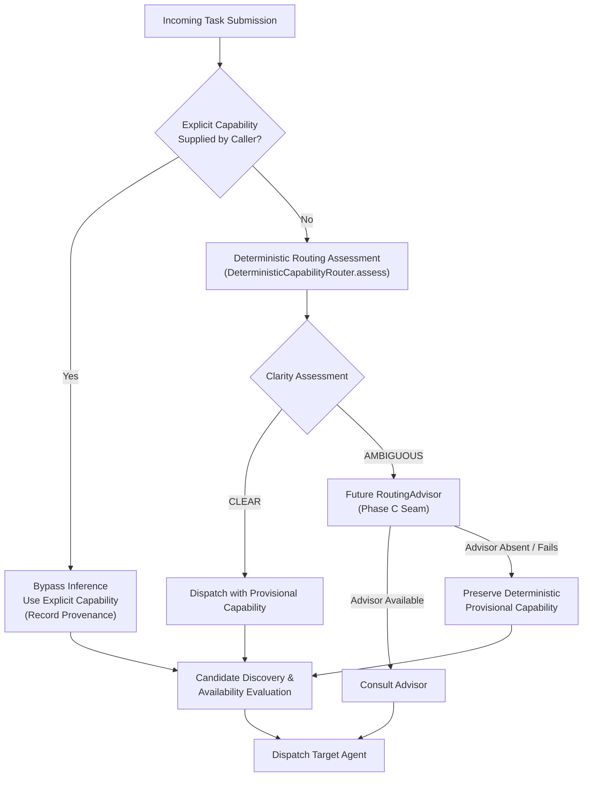

# Routing Evaluation, Deterministic Assessment & Hybrid Advisory Architecture

This document describes the routing evaluation dataset, benchmark runner, empirical baseline, Phase B deterministic assessment architecture, and the Phase C1 provider-neutral hybrid advisory architecture established for the capability routing subsystem in `autonomous-agent-lab`.

---

## 1. Purpose

The capability router directs incoming task prompts to the appropriate specialized agent (such as `AgentCapability.GENERAL` or `AgentCapability.RESEARCH`). 

As the platform evaluates potential improvements to capability routing (GitHub issue #91), an empirical baseline and typed assessment architecture are required to:
- Objectively quantify routing accuracy, precision, recall, and false-positive rates against ground truth.
- Evolve routing from returning a bare capability enum into producing a transparent [`RoutingAssessment`](../services/orchestrator/src/orchestrator/domain/assessment.py).
- Distinguish between **CLEAR** and **AMBIGUOUS** deterministic signals without relying on uncalibrated numeric confidence scores.
- Establish an architectural seam for a future `RoutingAdvisor` that is consulted only when deterministic evidence is ambiguous.
- Preserve backward-compatible `route(prompt) -> AgentCapability` execution across the system.

---

## 2. Dataset Architecture: Development vs. Development-Adjacent Validation

Routing evaluation is separated into two version-controlled datasets to distinguish development iteration from regression and adversarial coverage:

1. **Development Dataset** ([`evaluation/routing/dataset.json`](../evaluation/routing/dataset.json)): 44 curated test cases across 9 categories used to define and evaluate initial baseline signals. A 100% score on this dataset indicates that all known development cases pass, not universal production accuracy.
2. **Validation Dataset** ([`evaluation/routing/validation_dataset.json`](../evaluation/routing/validation_dataset.json)): 34 diverse test cases and adversarial prompts created during the same implementation cycle. This dataset provides regression and adversarial coverage for weak-verb disambiguation, diagnostic artifacts, and edge cases.

> [!IMPORTANT]
> Development-set and validation-set metrics are always reported separately.
> - The 44-case dataset is the primary development dataset.
> - The 34-case validation dataset was created during the same implementation cycle; its results provide regression and adversarial coverage rather than an unbiased production-accuracy estimate.
> - An unbiased production-accuracy estimate requires a future independent lockbox dataset created independently after the implementation is frozen.

### Schema

```json
{
  "id": "eval-001",
  "prompt": "What is 15% of 850?",
  "expected_capability": "general",
  "clarity": "clear",
  "rationale": "Direct arithmetic computation that does not require external evidence or live web retrieval.",
  "category": "clear_general",
  "tags": ["math", "calculation", "deterministic"]
}
```

| Field | Type | Description |
|---|---|---|
| `id` | `string` | Unique identifier (e.g., `eval-001` or `val-001`). |
| `prompt` | `string` | The task instruction presented to the router (including short inline artifacts where applicable). |
| `expected_capability` | `"general" \| "research"` | Ground-truth capability required to complete the task. |
| `clarity` | `"clear" \| "ambiguous"` | Whether the intent is unequivocally clear or a borderline/mixed-intent case. |
| `rationale` | `string` | Architectural justification for the assigned ground truth label. |
| `category` | `string` | The functional evaluation category. |
| `tags` | `list[string]` | Keywords indexing prompt characteristics. |

### Categories Covered Across Datasets

- **Development Dataset (44 cases)**: `clear_general`, `clear_research`, `ambiguous_borderline`, `freshness_current_info`, `explicit_sources_evidence`, `explanatory_general`, `code_transformation`, `multi_clause_mixed`, `research_keywords_negative`.
- **Validation Dataset (34 cases)**: `weak_verb_supplied_artifact`, `freshness_current_info`, `supported_versions_compatibility`, `changing_prices_availability`, `external_standards_guidance`, `historical_established_advances`, `negative_current_program_state`, `negative_current_electrical`, `vague_insufficient_evidence`, `mixed_supplied_and_external`, `compound_retrieval_prerequisite`, `weak_verb_alone`, `package_management_installation`, `personal_activity_temporal`, `diagnostic_evidence_supplied_artifact`, `volatile_demographic_freshness`.

---

## 3. Ground Truth Labeling Principles

### Independence from Router Implementations
Ground truth labels represent **human architectural intent**, not the behavior of any existing router. An expected label must never be assigned simply because an existing regular expression or keyword list triggers on it.

### Evaluation Criteria
A prompt is labeled `expected_capability: "research"` if and only if:
- It requires up-to-date, live, or changing information past standard model training cutoffs (e.g., current pricing, recent releases, breaking news).
- It explicitly demands external source retrieval, URL citations, whitepapers, or peer-reviewed literature.
- Completing the task accurately depends on querying external search engines or verification tools.

A prompt is labeled `expected_capability: "general"` if:
- It asks for code synthesis, refactoring, formatting, debugging, or transformation of user-supplied code or inline artifacts.
- It asks for established concepts, definitions, mathematical calculations, or textbook algorithms.
- It uses words like "analyze", "compare", or "benchmark" to describe a local calculation or code analysis on user-supplied input.

### Criteria for Clear vs. Ambiguous
- **`clear`**: Intent is unambiguous. Any experienced software engineer would classify the required agent capability identically without needing further context.
- **`ambiguous`**: The prompt combines mixed signals, lacks temporal context, or could be answered adequately by either general synthesis or live retrieval depending on user expectations. For example, in `eval-013` (*"Tell me about quantum computing advancements"*), both a general historical overview and a current research interpretation are plausible; assigning `expected_capability: "research"` is a deliberate Tiny Robot policy choice for an ambiguous prompt to prioritize recent developments.

---

## 4. Phase B: Deterministic Routing Assessment Architecture

Phase B transitions the capability router from returning a flat `AgentCapability` enum to producing an immutable, inspectable [`RoutingAssessment`](../services/orchestrator/src/orchestrator/domain/assessment.py).

### Domain Model

```python
@dataclass(frozen=True)
class RoutingAssessment:
    provisional_capability: AgentCapability
    clarity: RoutingClarity
    signals: tuple[RoutingSignal, ...]
    reason: str
```

### Routing Authority Order



1. **Caller-Supplied Explicit Capability**: An explicit capability override is always authoritative. It bypasses deterministic inference and any advisor, while strictly preserving candidate discovery, availability checks, selection, and transport dispatch.
2. **Deterministic Routing**: The primary inference mechanism. Evaluates typed signals at microsecond speed. When assessment clarity is `CLEAR`, the provisional capability is immediately resolved without calling any advisor.
3. **RoutingAdvisor (Phase C1 Seam)**: Consulted **only** when assessment clarity is `AMBIGUOUS`. Advisory only.
4. **Resilient Fallback**: If an advisor is absent, times out, or fails, the orchestrator preserves the deterministic provisional capability rather than failing or unprincipled fallback.

---

## 5. Phase C1: Provider-Neutral RoutingAdvisor and Hybrid Routing Policy

Phase C1 introduces a provider-neutral application boundary through which an optional routing advisor may recommend a capability for prompts where deterministic analysis is ambiguous.

### Boundary & Contracts

- **Protocol**: [`RoutingAdvisor`](../services/orchestrator/src/orchestrator/application/ports.py) in orchestrator application layer:
  ```python
  @runtime_checkable
  class RoutingAdvisor(Protocol):
      async def advise(
          self, prompt: str, assessment: RoutingAssessment
      ) -> AdvisorRecommendation: ...
  ```
- **Contract**: [`AdvisorRecommendation`](../services/orchestrator/src/orchestrator/domain/advisor.py) in domain layer:
  ```python
  @dataclass(frozen=True)
  class AdvisorRecommendation:
      recommended_capability: AgentCapability
      reason: str
  ```
  - `recommended_capability` must be an `AgentCapability` instance.
  - `reason` must be a non-empty string.
  - Strict anti-corruption validation prevents the advisor from returning agent identity patterns (e.g. `worker-`, `research-agent-`), dispatch targets (`agent.tasks.`, `tasks.`), or execution commands (`dispatch to`, `execute on`).
- **Exception Hierarchy**:
  - `AdvisorError(Exception)`
  - `AdvisorUnavailableError(AdvisorError)`
  - `AdvisorTimeoutError(AdvisorError)`
  - `AdvisorExecutionError(AdvisorError)`

### Strict Hierarchy of Authority

1. **Explicit Caller Capability Override**: Absolute authority. Bypasses deterministic assessment and advisor entirely.
2. **Deterministic RoutingAssessment**: Always runs when no override is present. If `clarity == RoutingClarity.CLEAR`, the orchestrator immediately resolves to `provisional_capability`. The advisor is never consulted.
3. **RoutingAdvisor**: Consulted ONLY when deterministic assessment is `RoutingClarity.AMBIGUOUS`. The advisor is strictly advisory—it recommends a capability, but cannot select agents or dictate dispatch targets.
4. **Deterministic Provisional Fallback**: If the advisor is not configured, unavailable, or times out, the orchestrator falls back to `provisional_capability`.

### Failure Model

- **Expected Provider Failures**: `AdvisorUnavailableError`, `AdvisorTimeoutError`, `AdvisorExecutionError`, and `TimeoutError` are caught gracefully. The orchestrator logs the fallback in provenance and resolves to the deterministic `provisional_capability`.
- **Contract Violations**: If an advisor returns an invalid object (not an `AdvisorRecommendation`), `SubmitTask` raises `TypeError` immediately (fail loudly), preventing corrupted data from polluting the routing pipeline.

### Decision Provenance

[`RoutingProvenance`](../packages/contracts/src/agent_contracts/routing.py) is persisted as part of every [`RoutingDecision`](../packages/contracts/src/agent_contracts/routing.py), answering:
1. `is_explicit_override: bool` — Was an explicit caller capability override provided?
2. `assessment_clarity: str | None` — Was deterministic clarity `"clear"` or `"ambiguous"`?
3. `provisional_capability: str | None` — What was the deterministic provisional capability?
4. `advisor_consulted: bool` — Was an external advisor consulted?
5. `advisor_verdict: str | None` — What was the advisor's action (`"agreed"`, `"changed"`, `"unavailable"`, `"timeout"`, `"failed"`, or `None`)?
6. `fallback_used: bool` — Did the orchestrator fall back to the provisional capability due to advisor failure?
7. `final_selection_reason: str` — What was the authoritative reason for the final capability?

### Scope & Provider Decoupling

Phase C1 introduces no Ollama, Cloudflare, local model, or network dependencies. Provider-specific implementations (e.g., Ollama adapter) are deferred to Phase C2, adhering to Clean Architecture principles.

### Plumbing Validation vs. Model-Quality Benchmarking

To verify the hybrid execution plumbing prior to introducing model providers (Phase C2), Phase C1 provides a deterministic test fixture: `SimulatedPlumbingAdvisor` in [`evaluation/routing/benchmark.py`](../evaluation/routing/benchmark.py).

`SimulatedPlumbingAdvisor` deterministically cycles through all hybrid plumbing branches for AMBIGUOUS assessments:
1. **Agreement** (step 0): Confirms the provisional capability.
2. **Override / Changed Recommendation** (step 1): Deliberately returns the opposite capability to verify that the orchestrator respects an advisor recommendation when it differs from the provisional assessment.
3. **Unavailable Fallback** (step 2): Raises `AdvisorUnavailableError` to verify fallback to the provisional capability.
4. **Timeout Fallback** (step 3): Raises `AdvisorTimeoutError` to verify fallback to the provisional capability.
5. **Execution Error Fallback** (step 4): Raises `AdvisorExecutionError` to verify fallback to the provisional capability.

> [!IMPORTANT]
> **Plumbing Verification is NOT Model-Quality Evidence**:
> The simulated advisor exists solely to verify wiring, fallback mechanics, and provenance logging. Because step 1 deliberately overrides the provisional capability, synthetic advisor overrides alter **final post-advisor routing accuracy** without retroactively altering **deterministic provisional capability accuracy**:
> - On the development dataset, case `eval-012` (*"What are the best practices for securing a REST API?"*) has expected capability `GENERAL`. The deterministic router provisionally selects `GENERAL` (100% correct). The simulated advisor deliberately changes it to `RESEARCH`, demonstrating that advisor overrides function as intended in dispatch decisions. This produces a final capability accuracy of 97.73% (43/44) while deterministic provisional accuracy remains 100.00% (44/44).
> - On the validation dataset, synthetic overrides on cases `val-022` and `val-029` similarly produce a final capability accuracy of 94.12% (32/34) while deterministic provisional accuracy remains 100.00% (34/34).

---

## 6. Signal Taxonomy & Core Routing Policies

### Signal Strength Tiers

| Signal Type | Target Capability | Strength | Description & Trigger Conditions |
|---|---|---|---|
| `EXPLICIT_SOURCES_OR_CITATIONS` | `RESEARCH` | `STRONG` | Explicit requests for literature, peer-reviewed studies, whitepapers, or source citations. |
| `FRESHNESS_OR_CURRENT_INFO` | `RESEARCH` | `STRONG` | Reusable temporal qualifiers (`today's`, `currently supported`, `latest release`, `current guidance`). |
| `CHANGING_EXTERNAL_INFO` | `RESEARCH` | `STRONG` | High-frequency changing information (`pricing tiers`, `stock market trends`, `breaking changes`). |
| `OUTSIDE_AUTHORITY_OR_PROVIDER` | `RESEARCH` | `STRONG` | Inquiries targeting specific external conferences, standards bodies (NIST, ISO), or vulnerability registries (NVD, CVE). |
| `RESEARCH_SYNTHESIS` | `RESEARCH` | `STRONG` | Scoped synthesis cues such as trends in a subject, a criterion-based comparison of technologies, a literature review, or a deep dive. |
| `EXPLICIT_EXTERNAL_RETRIEVAL` | `RESEARCH` | `STRONG` | Explicit directions to query live external search engines. |
| `SUPPLIED_LOCAL_ARTIFACT` | `GENERAL` | `STRONG` | Actual presence of structural markers (fenced code, diffs, stack traces, INI configs, JSON payloads). |
| `LOCAL_CODE_OR_DEBUGGING` | `GENERAL` | `STRONG` | Local coding/debugging tasks and explicit local targets (`write a python script`, `this exception`, `this stack trace`, `this function`). |
| `TRANSFORMATION_OR_REWRITE` | `GENERAL` | `STRONG` | Code or text transformations (`refactor this function`, `convert correlated subquery to CTE`). |
| `ESTABLISHED_CONCEPTUAL_EXPLANATION` | `GENERAL` | `STRONG` | Established computing theory, protocol mechanics, basic math, or physical science explanation. |
| `ALL_DATA_SUPPLIED_INLINE` | `GENERAL` | `STRONG` | Tasks where all necessary input data is provided inline. |
| `WEAK_RESEARCH_VERB` | `RESEARCH` | `WEAK` | Contextual verbs (`analyze`, `assess`, `compare`, `evaluate`, `benchmark`, `survey`, `conduct`, `research`, `investigate`, `study`, `explore`). |
| `COMPOUND_MIXED_TASK` | `RESEARCH` | `STRONG` | Multi-clause prompts combining external retrieval and local code synthesis. |

### Core Deterministic Policies

#### 1. Weak-Verb Policy
Weak research-like verbs (`analyze`, `assess`, `benchmark`, `compare`, `evaluate`, `survey`, `conduct`, `research`, `investigate`, `study`, `explore`) are contextual indicators and **must never independently determine RESEARCH**:
- **Weak verb + strong General evidence** -> `GENERAL / CLEAR` (e.g. *"Research this function and explain why the loop never terminates"*).
- **Weak verb + strong Research evidence** -> follows strong Research evidence (e.g. *"Research the latest developments in quantum computing"* -> `RESEARCH / CLEAR`).
- **Weak verb alone** -> provisional `GENERAL`, with clarity marked `AMBIGUOUS` (e.g. *"Research consensus algorithms"* -> `GENERAL / AMBIGUOUS`).
- The word "research" alone is never proof of external retrieval.

Scoped research-synthesis evidence can be strong without explicit freshness wording. Examples include trends in a subject, comparing technologies against a stated criterion, literature reviews, and deep dives. Explicit local code/debugging targets suppress these synthesis cues; generic verbs remain weak.

#### 2. Generalized Freshness & Negative Guards
Freshness is recognized when temporal qualifiers (`today`, `today's`, `current`, `currently`, `latest`, `recent`, `up-to-date`, `as of`) attach to volatile external facts (supported versions, releases, pricing, vulnerabilities, office holders, product capabilities, market conditions, standards or guidance).

**Negative Guards**: The word "current" does not trigger research when it refers to local program state (`current_user`, `current_node`, `current index`) or electrical current (`current of 10A`, `direct current`, `voltage drop given a current`).

#### 3. Generalized Supplied-Artifact Detection
`SUPPLIED_LOCAL_ARTIFACT` requires actual structural markers (fenced code blocks, stack traces, unified diffs, structured JSON/YAML/XML data, INI/TOML configuration blocks, or code constructs). Prompts merely containing words like "this" or "below" without actual content do not trigger artifact signals.

#### 4. Dynamic Reason Generation
Reasons are generated dynamically from the exact list of detected signals. Every reason accurately reflects the attached signals, never claims absent signals, and remains fully deterministic.

---

## 7. Benchmark Runner & CLI Options

The benchmark runner ([`evaluation/routing/benchmark.py`](../evaluation/routing/benchmark.py)) decouples correctness analysis from isolated latency profiling.

### Command-Line Interface

```bash
# 1. Run Phase B benchmark on the development dataset (Default)
PYTHONPATH="services/orchestrator/src:services/worker/src:services/research_agent/src:packages/contracts/src:." \
python -m evaluation.routing.benchmark

# 2. Run Phase B benchmark on the development-adjacent validation dataset
PYTHONPATH="services/orchestrator/src:services/worker/src:services/research_agent/src:packages/contracts/src:." \
python -m evaluation.routing.benchmark --validation

# 3. Run both development and validation datasets sequentially
PYTHONPATH="services/orchestrator/src:services/worker/src:services/research_agent/src:packages/contracts/src:." \
python -m evaluation.routing.benchmark --all

# 4. Reproduce frozen historical Routing v2 baseline (63.64%)
PYTHONPATH="services/orchestrator/src:services/worker/src:services/research_agent/src:packages/contracts/src:." \
python -m evaluation.routing.benchmark --baseline-v2

# 5. Validate simulated advisor plumbing on ambiguous cases
PYTHONPATH="services/orchestrator/src:services/worker/src:services/research_agent/src:packages/contracts/src:." \
python -m evaluation.routing.benchmark --simulate-advisor

# 6. Evaluate ambiguous cases with local model-backed Ollama advisor (Phase C2 experimental harness)
PYTHONPATH="services/orchestrator/src:services/worker/src:services/research_agent/src:packages/contracts/src:." \
python -m evaluation.routing.benchmark --advisor-provider ollama --ollama-model llama3.2:3b

# 7. Model evaluation with explicit cold probe, keep_alive retention, and post-run unloading
PYTHONPATH="services/orchestrator/src:services/worker/src:services/research_agent/src:packages/contracts/src:." \
python -m evaluation.routing.benchmark --advisor-provider ollama --ollama-model gemma3:1b --ollama-keep-alive 5m --cold-probe --unload-after-run
```

---

## 8. Phase C2: Model-Backed RoutingAdvisor Evaluation Harness (Experimental)

Phase C2 introduces experimental harness infrastructure to evaluate local language models (such as `gemma3:1b` or `llama3.2:3b` via Ollama) behind the provider-neutral `RoutingAdvisor` port.

> [!IMPORTANT]
> **Experimental Evaluation Status**:
> The Ollama advisor adapter ([`evaluation/routing/ollama_advisor.py`](../evaluation/routing/ollama_advisor.py)) and CLI flags are strictly experimental evaluation fixtures. They are **not** production orchestrator provider implementations. No external provider or running Ollama daemon is required for CI or automated pytest suites; all unit tests execute offline using deterministic mocks.

### Prompt-Only Evaluation Mode
In Phase C2 prompt-only evaluation mode, the model receives only the raw task prompt embedded in a standardized classification instruction. Deterministic routing assessment reasons, detected signal types, provisional capability decisions, and ground-truth dataset labels are **deliberately withheld** from the prompt. This prevents the model from anchoring on deterministic heuristics and measures true independent task disambiguation ability.

### Outcome Interpretation: Changes vs. Regressions
When an advisor is consulted on an ambiguous assessment, the outcome falls into one of four mutually exclusive quality categories:
1. **Correct Change**: The deterministic provisional capability disagreed with expected ground truth, and the advisor recommendation changed the final decision to the correct capability.
2. **Regression**: The deterministic provisional capability was correct, but the advisor recommendation changed the final decision to an incorrect capability.
3. **Preserved Correct**: The deterministic provisional capability was correct, and the advisor agreed (or gracefully fell back on failure), preserving the correct capability.
4. **Preserved Incorrect**: The deterministic provisional capability was incorrect, and the advisor either agreed with the incorrect capability or fell back without resolving the error.

### Latency Separation: Deterministic Baseline vs. Model Advisor
The benchmark strictly isolates microsecond deterministic router performance from model inference latency:
- **Deterministic Latency**: Measured in microseconds (`µs`) over repeated iterations of `router.route(prompt)`. It never invokes an advisor.
- **Advisor Latency**: Reported separately in milliseconds (`ms`). Both client-observed wall-clock duration and provider-reported telemetry (`total_duration`, `load_duration`, `prompt_eval_duration`, `eval_duration`) are tracked. Because the ambiguous subsets are small (5 development cases, 8 validation cases), percentiles are labeled descriptive measurements rather than statistical significance indicators.

### Cold-Probe vs. Warm-Scored Methodology
To ensure fair and reproducible CPU-only evaluation on local hosts (such as `home-core`):
1. **Cold Probe**: An isolated, non-scored baseline request ([`COLD_PROBE_PROMPT`](../evaluation/routing/benchmark.py)) can be executed prior to the scored evaluation run via `--cold-probe`. If model unloading via `keep_alive=0` succeeded immediately prior, it is labeled as an explicitly unloaded cold probe; otherwise it is labeled as an unverified cold start. The cold probe is **strictly excluded** from dataset accuracy scoring and warm latency distribution calculations.
2. **Warm Scored Run**: The harness scores ambiguous dataset cases sequentially after the cold probe. `--ollama-keep-alive` (e.g. `5m`) ensures the model remains resident in memory throughout the scored run.
3. **Post-Run Cleanup**: If `--unload-after-run` is passed, the harness issues an explicit `keep_alive=0` unload request to free memory upon benchmark completion.

> [!WARNING]
> **Evaluation Dataset Caveat**:
> Accuracy and latency metrics on the 44-case development dataset and 34-case validation dataset are diagnostic calibration tools, not unbiased production accuracy estimates. An unbiased evaluation requires a future independent lockbox dataset authored independently after implementation freezing.

---

## 9. Baseline Empirical Results (Phases A, B & C1)

### Comparative Performance Table

| Metric | Phase A: Routing v2 Baseline | Phase B: Development Dataset | Phase B: Validation Dataset | Phase C1: Simulated Advisor (Plumbing Test) |
|---|:---:|:---:|:---:|:---:|
| **Cases Evaluated** | 44 | 44 | 34 | 44 / 34 |
| **Provisional Capability Accuracy (Deterministic)** | **63.64%** (28/44) | **100.00%** (44/44) | **100.00%** (34/34) | **100.00%** (44/44) / **100.00%** (34/34) |
| **Final Capability Accuracy (Post-Advisor)** | **63.64%** (28/44) | **100.00%** (44/44) | **100.00%** (34/34) | **97.73%** (43/44) / **94.12%** (32/34) * |
| **Clarity Label Alignment** | 88.64% (39/44) | **100.00%** (44/44) | **100.00%** (34/34) | **100.00%** |
| **Advisor Delegation Rate** | 0.00% (0/44) | **11.36%** (5/44) | **23.53%** (8/34) | **11.36%** / **23.53%** |
| **Clear Prompt Advisor Invocations** | N/A | 0 (enforced) | 0 (enforced) | **0 (enforced)** |
| **Capability Acc (Assessed CLEAR)** | 63.64% | **100.00%** (39/39) | **100.00%** (26/26) | **100.00%** |
| **Capability Acc (Assessed AMBIGUOUS, Provisional)** | 0.00% | **100.00%** (5/5) | **100.00%** (8/8) | **100.00%** (5/5) / **100.00%** (8/8) |
| **Capability Acc (Assessed AMBIGUOUS, Final Post-Simulation)** | 0.00% | **100.00%** (5/5) | **100.00%** (8/8) | **80.00%** (4/5) / **75.00%** (6/8) * |
| **Research Precision / Recall / F1 (Final)** | 0.56 / 0.56 / 0.56 | **1.00 / 1.00 / 1.00** | **1.00 / 1.00 / 1.00** | **0.95 / 1.00 / 0.97** (dev) / **0.89 / 1.00 / 0.94** (val) |
| **General Precision / Recall / F1 (Final)** | 0.69 / 0.69 / 0.69 | **1.00 / 1.00 / 1.00** | **1.00 / 1.00 / 1.00** | **1.00 / 0.96 / 0.98** (dev) / **1.00 / 0.89 / 0.94** (val) |
| **Median Execution Latency (P50)** | **~50 µs** | **~110 µs** | **~100 µs** | **~130 µs** |

\* *Note on Phase C1 Final Accuracy: The simulated plumbing advisor intentionally exercises synthetic overrides on step 1 of its cycle (`eval-012` on dev; `val-022` and `val-029` on val) to prove that changed advisor recommendations alter the final dispatch decision. This validates plumbing mechanics, not model intelligence.*

---

## 10. Phase C2 Empirical Results: home-core Evaluation

This section documents the empirical Routing v3 Phase C2 evaluation results collected manually on the physical host `home-core`.

### 10.1 Evaluation Environment (`home-core`)

- **Host OS**: Ubuntu 26.04.1 LTS
- **Python**: CPython 3.12.16 within project-local `.venv`
- **Ollama**: 0.40.15 (CPU-only execution for all C2 repository benchmark runs)
- **Integrated GPU**: AMD Radeon Vega 8 Graphics (RADV RAVEN)
- **Vulkan Driver**: Mesa RADV (ROCm was not used for the Vulkan experiments)
- **llama.cpp Experimental Build**: Commit `372dc5ca1`, build identifier `b12199-372dc5ca1`
- **llama.cpp Vulkan Capabilities**: Reported `uma=1`, `fp16=1`, `int dot=0`, `matrix cores=none`
- **Device Enumeration**: `Vulkan0: AMD Radeon Vega 8 Graphics (RADV RAVEN)` (~7966 MiB visible, ~7922 MiB free at enumeration)
- **Weight Storage**: Existing Ollama GGUF weight blobs were reused read-only across llama.cpp experiments.

### 10.2 Strict Separation of Experimental Contexts

To avoid conflation across distinct experimental layers, results are partitioned into five separate measurement contexts:

1. **Ollama CPU Model-Backed Benchmark Results**: Produced directly by the repository evaluation harness (`evaluation/routing/benchmark.py`) under standard CPU-only Ollama execution.
2. **Exploratory llama.cpp + Mesa RADV/Vulkan Hardware Experiments**: Conducted directly against llama.cpp binaries to assess integrated GPU acceleration via Vulkan.
3. **Synthetic `llama-bench` Throughput Measurements**: Synthetic micro-benchmarks measuring raw token-processing throughput, strictly decoupled from end-to-end routing latency.
4. **Persistent `llama-server` Measurements**: Request-level latency measurements under schema-constrained generation with prefix caching on Vulkan.
5. **Temporary 13-Case Qwen/Vulkan Ambiguous-Case Experiment**: A standalone external batch run across all 13 ambiguous cases, not produced by the repository harness.

> [!IMPORTANT]
> Exploratory llama.cpp measurements must **not** be presented as or conflated with repository benchmark harness results. Only Section 10.3 reflects runs executed through `evaluation/routing/benchmark.py`.

---

### 10.3 Ollama CPU Model-Backed Benchmark Results (Repository Harness)

The repository benchmark harness was executed against Ollama running on CPU for four candidate model configurations across the development dataset (5 ambiguous cases) and validation dataset (8 ambiguous cases).

#### Comparative Model Performance Table

| Metric | Deterministic Baseline | Gemma 3 1B (`gemma3:1b`) | Llama 3.2 3B (`llama3.2:3b`) [Dev] | Llama 3.2 3B (`llama3.2:3b`) [Val] | Qwen3 1.7B (`qwen3:1.7b`) | Phi-4 Mini (`phi4-mini`) |
|---|:---:|:---:|:---:|:---:|:---:|:---:|
| **Dataset** | Dev / Val | Development (44) | Development (44) | Validation (34) | Development (44) | Development (44) |
| **Ambiguous Eligible** | 5 / 8 | 5 | 5 | 8 | 5 | 5 |
| **Successful Recommendations** | N/A | 5 | 5 | 8 | 2 | 5 |
| **Completed Semantic Accuracy** | **100.00%** | 60.00% (3/5) | 80.00% (4/5) | 62.50% (5/8) | 100.00% (2/2) * | 80.00% (4/5) |
| **Agreements** | N/A | 3 | 4 | 5 | 2 | 4 |
| **Changes** | N/A | 2 | 1 | 3 | 0 | 1 |
| **Correct Changes** | N/A | **0** | **0** | **0** | **0** | **0** |
| **Regressions** | N/A | **2** | **1** | **3** | **0** | **1** |
| **Fallbacks (Preserved)** | N/A | 0 | 0 | 0 | 3 (timeouts) | 0 |
| **CLEAR Advisor Invocations** | 0 (enforced) | 0 (enforced) | 0 (enforced) | 0 (enforced) | 0 (enforced) | 0 (enforced) |
| **Provisional Ambiguous Acc** | **100.00%** | **100.00%** (5/5) | **100.00%** (5/5) | **100.00%** (8/8) | **100.00%** (5/5) | **100.00%** (5/5) |
| **Final Ambiguous Accuracy** | **100.00%** | 60.00% (3/5) | 80.00% (4/5) | 62.50% (5/8) | **100.00%** (5/5) † | 80.00% (4/5) |
| **Overall Final Accuracy** | **100.00%** | 95.45% (42/44) | 97.73% (43/44) | 91.18% (31/34) | **100.00%** (44/44) † | 97.73% (43/44) |
| **Warm Wall-Clock Mean** | ~0.11 ms | 5,499.98 ms | 7,741.27 ms | 7,999.67 ms | 23,200.13 ms | 8,563.95 ms |
| **Cold Probe Latency** | N/A | 7,798.27 ms | 16,863.09 ms | 16,833.92 ms | 27,172.65 ms | 16,448.10 ms |

\* *Interpret Qwen3 1.7B completed semantic accuracy (2/2) carefully: This represents accuracy on completed responses only. 3 of the 5 eligible cases failed via timeout, so the model succeeded on only 40% of attempted consultations.*
† *Final accuracy remained 100% under Qwen3 1.7B solely because the orchestrator's resilient fallback mechanism preserved the correct deterministic provisional capability when advisor timeouts occurred.*

#### Detailed Model Findings

1. **Gemma 3 1B (`gemma3:1b`)**:
   - Completed 5 of 5 ambiguous consultations.
   - Agreed with the provisional capability on 3 cases; changed 2 cases.
   - Introduced **2 regressions** (0 correct changes), reducing final ambiguous accuracy to 60.00% (overall 95.45%):
     - `eval-013` (*"Tell me about quantum computing advancements"*): Expected `RESEARCH`, model recommended `GENERAL`.
     - `eval-014` (*"How is AI impacting software engineering jobs right now?"*): Expected `RESEARCH`, model recommended `GENERAL`.
   - Warm latency averaged 5,500 ms; cold probe required 7,798 ms.

2. **Llama 3.2 3B (`llama3.2:3b`) [Development Dataset]**:
   - Completed 5 of 5 ambiguous consultations.
   - Agreed on 4 cases; changed 1 case.
   - Introduced **1 regression** (0 correct changes), reducing final ambiguous accuracy to 80.00% (overall 97.73%):
     - `eval-014` (*"How is AI impacting software engineering jobs right now?"*): Expected `RESEARCH`, model recommended `GENERAL`.
   - Warm latency averaged 7,741 ms; cold probe required 16,863 ms.

3. **Llama 3.2 3B (`llama3.2:3b`) [Validation Dataset]**:
   - Completed 8 of 8 ambiguous consultations.
   - Agreed on 5 cases; changed 3 cases.
   - Introduced **3 regressions** (0 correct changes), reducing final ambiguous accuracy to 62.50% (overall 91.18%):
     - `val-024` (*"What is the job market for healthcare workers right now?"*): Expected `RESEARCH`, model recommended `GENERAL`.
     - `val-025` (*"Compare our current database configuration with recent cloud vendor benchmark recommendations"*): Expected `RESEARCH`, model recommended `GENERAL`.
     - `val-029` (*"Survey available vector databases for hybrid search"*): Expected `GENERAL`, model recommended `RESEARCH`.
   - Warm latency averaged 8,000 ms; cold probe required 16,834 ms.

4. **Qwen3 1.7B (`qwen3:1.7b`)**:
   - Encountered severe CPU latency limitations.
   - Successfully completed only 2 of 5 consultations; the remaining 3 consultations exceeded the 30-second timeout threshold (~30,000 ms each).
   - Among the 2 completed responses, both agreed with the deterministic provisional capability (2/2 semantic accuracy, 0 regressions).
   - Resilient fallback triggered on the 3 timed-out cases, preserving the correct deterministic capability and yielding 44/44 (100%) final accuracy.
   - Successful warm consultations averaged 23,200 ms; cold probe required 27,173 ms.

5. **Phi-4 Mini (`phi4-mini`)**:
   - Completed 5 of 5 ambiguous consultations.
   - Agreed on 4 cases; changed 1 case.
   - Introduced **1 regression** (0 correct changes), reducing final ambiguous accuracy to 80.00% (overall 97.73%):
     - `eval-011` (*"Compare PostgreSQL and MongoDB for time-series data storage"*): Expected `GENERAL`, model recommended `RESEARCH`.
   - Warm latency averaged 8,564 ms; cold probe required 16,448 ms.

---

### 10.4 Exploratory llama.cpp + Mesa RADV/Vulkan Hardware Experiments

To assess whether hardware acceleration on integrated AMD graphics could mitigate the severe CPU latency observed under Ollama, exploratory experiments were conducted using `llama.cpp` compiled with Vulkan support via Mesa RADV.

> [!NOTE]
> These exploratory benchmarks were run directly using standalone `llama.cpp` tools (`llama-bench` and `llama-server`) with existing Ollama GGUF model weights. They were **not** executed via the repository benchmark harness.

#### 10.4.1 Synthetic Backend Throughput (`llama-bench`)

Synthetic throughput was evaluated using `llama-bench` across prompt evaluation (`pp512`) and text generation (`tg128` and `tg32`):

| Model | Quantization | Backend | Prompt Processing (`pp512`) | Generation (`tg128`) | Generation (`tg32`) | Speedup Factor |
|---|---|:---:|:---:|:---:|:---:|:---:|
| **Gemma 3 1B** | Q4_K_M | CPU | 55.30 – 56.50 t/s | 17.62 t/s | 17.66 t/s | Baseline |
| **Gemma 3 1B** | Q4_K_M | Vulkan (RADV) | **538.36 – 539.33 t/s** | 17.12 t/s | 17.10 t/s | **~9.5x – 9.7x prompt speedup** (generation flat) |
| **Llama 3.2 3B** | Q4_K_M | CPU | 22.14 t/s | — | 7.31 t/s | Baseline |
| **Llama 3.2 3B** | Q4_K_M | Vulkan (RADV) | **117.32 t/s** | — | 7.33 t/s | **~5.3x prompt speedup** (generation flat) |
| **Qwen3 1.7B** | Q4_K_M | CPU | 42.45 t/s | — | 12.34 t/s | Baseline |
| **Qwen3 1.7B** | Q4_K_M | Vulkan (RADV) | **261.18 t/s** | — | 12.24 t/s | **~6.15x prompt speedup** (generation flat) |

**Key Hardware Finding**:
- Vulkan delivers a dramatic **5.3x to 9.7x acceleration in prompt evaluation** (`pp512`) on the Vega 8 integrated GPU.
- Generation throughput (`tg32` / `tg128`) remains **essentially unchanged or marginally slower** across all models. On integrated unified memory architectures (UMA), autoregressive token generation is strictly memory-bandwidth bound.
- *Distinction*: These figures represent raw token-processing throughput and must not be conflated with end-to-end task routing latency.

#### 10.4.2 Persistent `llama-server` Measurements & Prefix Caching

Using `llama-server` with models resident in memory, JSON schema constrained generation, and the exact C2 evaluation prompt policy (`format_evaluation_prompt()`), requests were evaluated on the test prompt:
> *"How is AI impacting software engineering jobs right now?"*

1. **Gemma 3 1B + Vulkan**:
   - First request (cold prompt): ~2.53 s.
   - Cached warm requests: ~2.05 – 2.06 s total wall-clock.
   - Latency decomposition: Prompt evaluation required ~0.18 – 0.19 s; generation required ~1.86 – 1.88 s.
   - At a 32-token limit, the JSON output was truncated. The model classified the prompt as `GENERAL`, which is incorrect under C2 ground truth.
2. **Llama 3.2 3B + Vulkan**:
   - First request: ~5.91 s.
   - Cached warm requests: ~4.42 – 4.46 s total wall-clock.
   - Latency decomposition: Prompt evaluation required ~0.16 s; generation required ~4.26 – 4.30 s.
   - At a 32-token limit, the JSON output was truncated. The model classified the prompt as `GENERAL`, which is incorrect under C2 ground truth.
3. **Qwen3 1.7B + Vulkan**:
   - At a 32-token limit: Initial request ~3.50 s; warm requests ~2.71 – 2.72 s. Correctly classified as `RESEARCH`, but the JSON payload was truncated before closing braces.
   - At a 64-token limit: The model naturally completed after 40 generated tokens with an EOS stop token, producing complete, schema-valid JSON.
   - Repeated warm requests required **~3.43 – 3.47 s**.
   - Output classification: `capability="research"`, correctly citing the need for current information regarding the impact of AI on software engineering jobs.

**Latency Bottleneck Insight**:
Once prefix caching eliminates prompt evaluation overhead (reducing prompt processing to ~160–190 ms), **token generation accounts for 90% to 96% of total request latency** (1.8 s to 4.3 s). Because generation throughput cannot be accelerated on this integrated GPU, wall-clock latency remains in the multi-second regime even with persistent resident servers.

#### 10.4.3 Temporary 13-Case Qwen/Vulkan Ambiguous Experiment

To evaluate semantic quality under accelerated inference, a temporary external experiment evaluated Qwen3 1.7B on `llama-server` (Vega 8 RADV/Vulkan, temperature 0, 64-token limit, strict JSON schema, exact C2 prompt policy) across all 13 ambiguous cases from both datasets (5 development + 8 validation).

> [!CAUTION]
> This was a temporary external experiment, **not** a repository benchmark harness run.

- **Total Cases Evaluated**: 13 (5 development, 8 validation)
- **Valid Complete JSON Responses**: 13/13 (100%)
- **Correct Recommendations**: 6/13 (46.15%)
  - Development dataset: 2/5 (40.00%)
  - Validation dataset: 4/8 (50.00%)
- **Incorrect Recommendations**: 7/13 (53.85%)
- **Deterministic Provisional Baseline on Same Cases**: **13/13 (100.00%)**
- **Correct Changes**: **0**
- **Regressions Introduced**: **7**
- **Wall-Clock Latency**: Mean 3,452.94 ms | Median 3,440.13 ms | Min 2,406.40 ms | Max 4,216.44 ms

**Regressions Introduced by Qwen/Vulkan**:
In all 7 regression cases, the deterministic provisional router correctly identified `GENERAL` based on established architectural and technology-comparison intent, but the model incorrectly recommended `RESEARCH`:
1. `eval-011` (*"Compare PostgreSQL and MongoDB for time-series data storage"*): Expected `GENERAL`, Qwen recommended `RESEARCH`.
2. `eval-012` (*"What are the best practices for securing a REST API?"*): Expected `GENERAL`, Qwen recommended `RESEARCH`.
3. `eval-015` (*"Evaluate whether our architecture should transition from microservices to a modular monolith"*): Expected `GENERAL`, Qwen recommended `RESEARCH`.
4. `val-022` (*"Compare Apache Kafka and RabbitMQ for distributed event streaming"*): Expected `GENERAL`, Qwen recommended `RESEARCH`.
5. `val-023` (*"What are the security best practices for Kubernetes secret management?"*): Expected `GENERAL`, Qwen recommended `RESEARCH`.
6. `val-029` (*"Survey available vector databases for hybrid search"*): Expected `GENERAL`, Qwen recommended `RESEARCH`.
7. `val-030` (*"Analyze the trade-offs of data portability across cloud providers"*): Expected `GENERAL`, Qwen recommended `RESEARCH`.

---

## 11. Empirical Conclusions & Policy Recommendations

### 11.1 Value of Negative Results & Architectural Decision

In accordance with project engineering principles (AGENTS.md Rules 6 & 11), negative experimental results are valuable architectural milestones that prevent unwarranted complexity:

1. **Zero Correct Changes**: No tested model, runtime, or hardware backend configuration produced a single correct change over deterministic provisional routing on the evaluated ambiguous cases.
2. **Systematic Degradation**: Every tested model either introduced accuracy regressions (1 to 7 misclassifications), failed due to latency timeouts, or both.
3. **Deterministic Superiority**: The deterministic `RoutingAssessment` was **100% correct** (13/13) across all ambiguous cases in both datasets, with sub-millisecond execution in the measured benchmark runs.
4. **Severe Latency Penalty**: Model inference added multi-second latency per ambiguous prompt, compared with sub-millisecond deterministic assessment in the measured benchmark runs, without delivering any semantic improvement.

> [!IMPORTANT]
> **Architectural Policy Decision**:
> - **Do not implement or select a production local routing advisor** based on these Phase C2 findings.
> - **Deterministic capability routing remains authoritative** for all task submissions.
> - The provider-neutral `RoutingAdvisor` interface and evaluation harness in `evaluation/routing/` will be preserved as an experimental test fixture for future model or hardware evaluations, but will **not** be integrated into the production orchestrator dependency graph.

### 11.2 Qualitative Lesson: The Complete Configuration Perspective

A critical qualitative conclusion from Phase C2 is that local model evaluation cannot evaluate a model name or parameter count in isolation. Evaluation validity requires specifying and measuring the complete runtime stack:

$$\text{Evaluation Stack} = \text{Model} + \text{Runtime} + \text{Hardware Backend} + \text{Residency/Prefix Strategy} + \text{Prompt Policy} + \text{Output Contract}$$

- **Parameter count is deceptive**: Gemma 3 1B and Qwen3 1.7B exhibited vastly different latency, prompt-processing throughput, and timeout profiles despite similar sizes.
- **Hardware acceleration has distinct bottlenecks**: Vulkan accelerated prompt evaluation by 5x to 10x, while autoregressive token-generation throughput remained essentially unchanged in these experiments.
- **Output size materially affects latency**: Under the tested Qwen configuration, complete schema-valid responses naturally required 40 generated tokens and took approximately 3.4 seconds, with token generation dominating warm request latency.
- **Syntactic compliance does not equal semantic alignment**: Qwen3 on Vulkan achieved 100% valid JSON adherence, but misclassified 54% of ambiguous cases by conflating architectural inquiries with external research.

---

## 12. Generalization Lessons & Historical Context

### Generalization Lessons from Phase B
Initial testing of Phase B against unseen prompts revealed that high development scores can mask narrow regex assumptions:
1. Overly specific literal patterns (e.g. naming specific APIs or conferences) fail when users query different vendors or events.
2. Treating weak verbs like "research", "compare", or "assess" as authoritative research triggers causes severe false positives on local code debugging and configuration comparisons.
3. Matching "current" without negative guards misclassifies local variables (`current_user`, `current_node`) and electrical measurements as freshness research.
4. Unqualified temporal phrases like "this week" or "this month" misclassify personal user statements ("I started learning Rust this week") unless gated against personal activity.
5. "Find evidence" applied to supplied diagnostic artifacts (such as heap dumps or stack traces) represents local inspection rather than academic/literature retrieval.

---

## 13. Non-Blocking Architectural Follow-ups

The following improvements remain documented for future evaluation cycles:
1. **Persist RoutingAssessment Diagnostics**: Extend `RoutingDecision` (or add a companion `RoutingAssessmentRecord`) to persist assessment clarity, typed signals, and signal-backed reasoning alongside the dispatch decision, exposing them to the observatory and debugging APIs.
2. **Decompose Freshness Regex**: Decompose the large monolithic `FRESHNESS_OR_CURRENT_INFO` pattern into a collection of smaller named semantic sub-patterns (e.g., `supported_versions`, `pricing_queries`, `service_status`, `demographic_counts`) compiled at router initialization.
3. **Invert Freshness Whitelisting**: Replace the current term-based whitelist in `_is_false_freshness` with positively matched context guards, ensuring that new freshness qualifiers are not inadvertently suppressed.
4. **Independent Lockbox Dataset**: Create a third, truly independent lockbox evaluation dataset authored by an external contributor or at a later date after deterministic rules are completely frozen, establishing an unbiased production-accuracy estimate.
5. **Future Model Architecture Evaluations**: Retain the evaluation-only Ollama and benchmark harness infrastructure to evaluate future small language models (e.g., specialized routing SLMs or fine-tuned classifiers) or alternative execution backends if dedicated GPU hardware becomes available.
